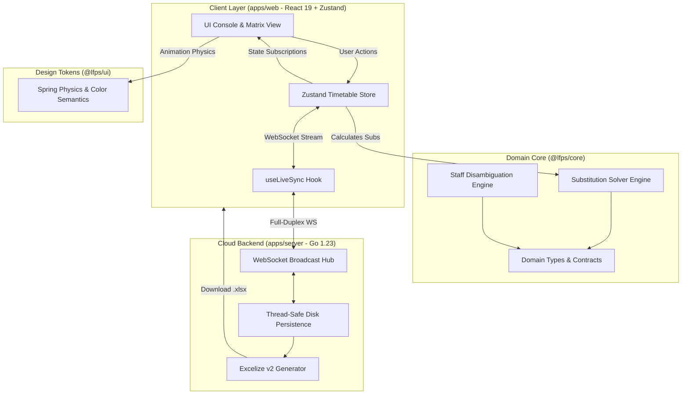
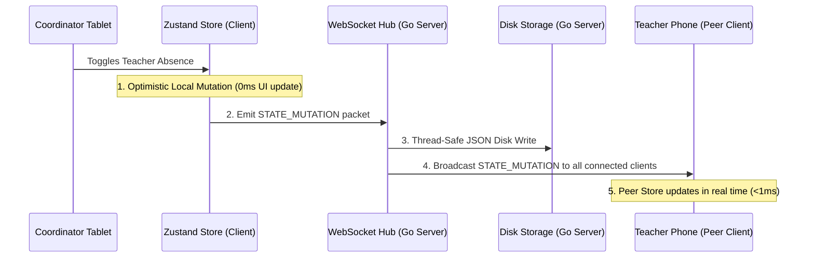

# Little Flower Preparatory School (LFPS) Substitutions Manager — Architecture Blueprint (v2.0 Next-Gen)

This document outlines the architectural principles, domain modeling, package boundaries, state machines, and real-time synchronization pipelines powering the **LFPS Substitutions Manager Next-Gen v2.0** suite.

---

## 1. Architectural Principles & Prime Directive

1. **Clean Separation of Concerns**: Strict boundary isolation across Domain Business Logic (`@lfps/core`), Design Tokens & Physics (`@lfps/ui`), Interactive Client PWA (`apps/web`), and Cloud Microservices (`apps/server`).
2. **Strict Type Safety & Immutability**: All schedule data models, period definitions, teacher records, and solver plans are strictly typed with zero `any` declarations. State mutations are deterministic and test-backed.
3. **Apple-Grade Human Interface Guidelines (HIG)**: Fluid spring physics, 120fps uncapped GPU-composited animations (`transform`, `opacity`), tactile direct manipulation, microcopy clarity, and zero visual clutter.
4. **Local-First with Real-Time Cloud Synchronization**: The client operates with zero latency using optimistic updates and local offline persistence, continuously broadcasting state changes over full-duplex WebSockets to connected staff devices and the Go cloud backend.

---

## 2. Monorepo Topology

```
LFPS_Substitutions_Manager/
├── packages/
│   ├── core/                    # Pure TypeScript Domain Engine & Solver
│   │   ├── src/
│   │   │   ├── types.ts         # Domain models (Teacher, DailySchedule, Substitutions, Absences)
│   │   │   ├── constants.ts     # Master baseline seed data & default periods
│   │   │   ├── disambiguation.ts# Staff ID & role qualification disambiguation
│   │   │   ├── solver.ts        # Pure TS Candidate Substitution Solver & Auto-Resolve
│   │   │   └── index.ts         # Public package barrel export
│   │   └── test/
│   │       └── solver.test.ts   # Vitest unit test suite (100% passing)
│   │
│   └── ui/                      # Apple HIG Design Tokens & Animation Physics
│       └── src/
│           ├── tokens.ts        # Springs (snappy, bouncy, smooth), color roles, glass presets
│           └── index.ts         # Public UI tokens export
│
├── apps/
│   ├── web/                     # Next-Gen React 19 Frontend PWA
│   │   ├── src/
│   │   │   ├── components/      # Apple-grade UI components
│   │   │   │   ├── Header.tsx             # Elevated console & Dynamic Island Day Bar
│   │   │   │   ├── AbsenceRoster.tsx       # Horizontal roster tray & Present badges
│   │   │   │   ├── SubstitutionsRegister.tsx# Ledger, Auto-Resolve, and live audit actions
│   │   │   │   ├── RoutineGrid.tsx        # Matrix with Fullscreen Workstation overlay
│   │   │   │   ├── MicroContextMenu.tsx    # Ultra-compact contextual popover
│   │   │   │   ├── SubAvailabilityModal.tsx# Hero staff duty & unavailability modal
│   │   │   │   ├── CoTeacherModal.tsx      # Per-period co-teacher inspector
│   │   │   │   └── OfficiatingModal.tsx    # Temporary Off. AC and Off. CT designation
│   │   │   ├── hooks/
│   │   │   │   └── useLiveSync.ts         # WebSocket live sync hook with auto-reconnect
│   │   │   ├── store/
│   │   │   │   └── useTimetableStore.ts   # Zustand unified reactive client store
│   │   │   ├── App.tsx                    # Root application component
│   │   │   └── main.tsx                   # React 19 hydration entrypoint
│   │   ├── package.json
│   │   └── vite.config.ts       # Vite 6 bundler configuration
│   │
│   └── server/                  # Go 1.23 High-Performance Service
│       ├── cmd/server/main.go   # Go service entrypoint (Port 8080)
│       ├── internal/
│       │   ├── ws/hub.go        # Full-duplex WebSocket hub (Gorilla WebSocket)
│       │   ├── storage/store.go # Thread-safe JSON disk snapshot engine
│       │   └── excel/generator.go # Excelize v2 XLSX daily report generator
│       ├── Dockerfile           # Multi-stage scratch Docker container (~15MB)
│       └── go.mod
│
├── legacy-v1/                   # Archived v1.53.0 vanilla code for parity auditing
├── assets/                      # Production build assets deployed to GitHub Pages root
├── index.html                   # Root entrypoint for zero-config GitHub Pages hosting
└── package.json                 # Monorepo workspaces configuration
```

---

## 3. High-Level System Architecture Diagram



---

## 4. Package Deep Dives

### 4.1 `@lfps/core`: Pure TypeScript Domain & Solver Engine
- **Purpose**: Houses the deterministic business rules of the school without any DOM, React, or browser dependencies.
- **Key Modules**:
  - `types.ts`: Strict types for `Teacher`, `DailySchedule`, `MasterSchedule`, `PeriodId`, `AbsenceRecord` (including `AWAY_OFFICIAL`), `StaffAvailabilityRecord`, `SubstitutionAssignment`, and `AutoResolvePlan`.
  - `solver.ts`:
    - `parseCellSlot()`: Parses cell strings (e.g., `"KG A Eng"`, `"PREP B Math + NUR A"`) into structured class and subject tokens.
    - `findAvailableSubstitutes()`: Discovers candidate teachers for any given period who are free from routine classes, not marked absent, and not marked "Free from Sub".
    - `calculateCandidateAffinity()`: Scores candidates based on subject specialization, class familiarity, and daily load balance.
    - `autoResolveSubstitutions()`: Generates an end-to-end multi-period substitution coverage proposal with zero double-bookings.
  - `disambiguation.ts`: Distinguishes staff sharing identical surnames by resolving unique `StaffId` and appending primary class qualifications (e.g. `Mrs. S. Lakra (KG A)`).
- **Verification**: Fully covered by Vitest unit tests (`packages/core/test/solver.test.ts`).

### 4.2 `@lfps/ui`: Design Tokens & Physics
- **Purpose**: Centralizes the tactile Apple HIG tokens used across all client components.
- **Physics Tokens**:
  - `SPRING_TRANSITIONS.snappy`: `{ stiffness: 450, damping: 32, mass: 0.8 }` — Micro-interactions, badges, toggles.
  - `SPRING_TRANSITIONS.smooth`: `{ stiffness: 260, damping: 28, mass: 1.2 }` — Drawers, bottom sheets, console transitions.
  - `ISLAND_SPRING`: `{ duration: 0.6, bounce: 0.12 }` — Symmetrical duration-based spring for Dynamic Island morphing.
- **Role Color Hierarchy**:
  - **Academic Coordinator (AC)**: Unified Purple (`#8b5cf6`)
  - **Assistant Academic Coordinator (AAC)**: Unified Purple (`#8b5cf6`)
  - **Class Teachers (CT)**: Teal-Sky (`#0284c7`)
  - **Subject Teachers (ST)**: iOS Blue (`#007aff`)
  - **Absent**: Crimson Red (`#ff3b30`)
  - **Away (Official)**: Slate Indigo (`#475569`)

### 4.3 `apps/web`: React 19 Next-Gen Client
- **Store Architecture (`useTimetableStore.ts`)**:
  - Unified Zustand store managing active day, live master schedule, absences, availability records, substitutions, and officiating roles.
  - State mutations execute optimistically in 0ms on the client and dispatch mutations over WebSocket.
- **Component Engineering**:
  - `Header.tsx`:
    - Features a 120fps uncapped scroll observer powered by `requestAnimationFrame`.
    - Dynamic Island Day Bar: Floating capsule at `top-3` that smoothly morphs from a compact pill into a wide day selector with symmetrical 600ms spring physics and a relaxed 4.8s auto-collapse timer. Full-screen backdrop dismisses on outside tap.
  - `RoutineGrid.tsx`:
    - Dual-view matrix (Teachers $\longleftrightarrow$ Classes).
    - **Fullscreen Workstation Overlay (`isFitGrid`)**: Expanding transforms the routine matrix into an edge-to-edge spreadsheet workstation with body scroll lock and <kbd>Esc</kbd> dismissal.
    - Sticky headers: Periods remain pinned at `sticky top-0 z-30`, teacher column remains pinned at `sticky left-0 z-20`, and the corner cell anchors securely at `sticky top-0 left-0 z-40`.
  - `AbsenceRoster.tsx`: High-density horizontal roster tray displaying teacher status pills with clean `Present` indicators and instant absence toggles.
  - `SubstitutionsRegister.tsx`: Real-time substitution ledger with 1-tap Smart Auto-Resolve solver.

### 4.4 `apps/server`: Go 1.23 Cloud Service
- **WebSocket Hub (`internal/ws/hub.go`)**:
  - Manages concurrent WebSocket client connections via thread-safe registration and unregistration channels.
  - Broadcasts `STATE_MUTATION` frames to all active coordinator tablets and phones within sub-millisecond latencies.
  - Built-in ping/pong keepalives ensure dead client connections are reaped cleanly.
> **Superseded (Job Bundles 34–35):** the server no longer persists to disk. It is a stateless live relay (`internal/livesync`, `internal/relay`) with a Google Sheets bridge (`internal/sheets`); see [`docs/SAS.md`](docs/SAS.md) §6.3 and §7. The items below describe the v1.x design.

- **Persistence (`internal/storage/store.go`)**:
  - RWMutex-synchronized disk persistence writing daily state snapshots to `data/state.json`.
  - Recovers active absences, substitutions, and officiating assignments across server reboots.
- **Excelize Engine (`internal/excel/generator.go`)**:
  - High-speed spreadsheet generation via `github.com/xuri/excelize/v2` in under 20ms.
  - Generates publication-ready daily substitution records with formal navy headers, class columns, substitution reasons, and Principal signature blocks.
  - Automatically saves timestamped daily snapshots (`data/backups/LFPS_Daily_Substitutions_YYYY-MM-DD.xlsx`).

---

## 5. State Synchronization Lifecycle



---

## 6. Performance & Animation Standards

1. **Uncapped 120fps Refresh Rates**: Animations use exclusively GPU-composited properties (`transform: translate3d(...) scale(...)`, `opacity`). Layout reflow triggers (`width`, `height`, `max-height`, `margin`) are strictly forbidden during runtime motion.
2. **Zero Layout Thrashing**: Framer Motion `layoutId` projections calculate bounding boxes off-DOM. Conflicting CSS `transition-transform` classes are eliminated to prevent frame stutter.
3. **Containing Block Discipline**: Modals and full-screen overlay backdrops are rendered at the root layer outside elements with CSS `transform` or `filter` to eliminate WebKit containing block trapping bugs.

---

## 7. Deployment Strategy

- **Static Frontend**: Compiled into `dist/` and synchronized to the workspace root for zero-config **GitHub Pages** continuous deployment from branch `next-gen` (`https://steph1420.github.io/LFPS_Substitutions_Manager/`).
- **Cloud Backend**: Containerized using a multi-stage Dockerfile (`golang:1.23-alpine` builder $\to$ `scratch` runtime) yielding a ~15MB image hosted on **Render** (`https://lfps-substitutions-manager.onrender.com`).