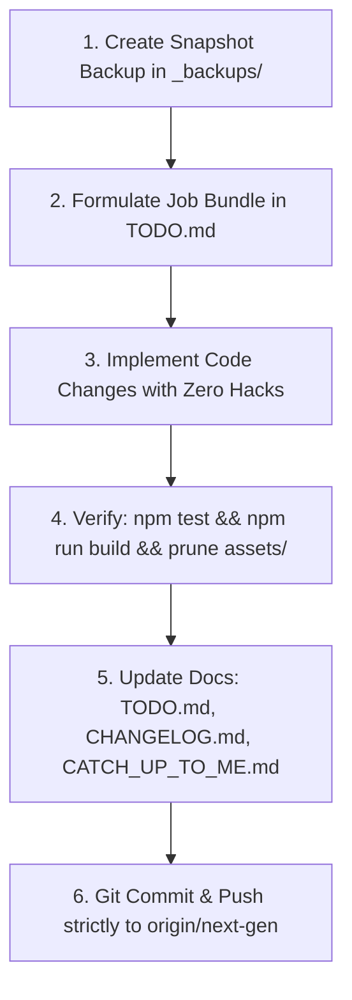

# CATCH UP TO ME: Operational Handover & Inter-Agent Transfer Protocol
*Little Flower Preparatory School (LFPS) Substitutions Manager & Master Routine Suite (Next-Gen v2.0)*

> **CRITICAL DIRECTIVE FOR THE INCOMING AI AGENT:**
> You are picking up work on this codebase because the user has switched accounts/sessions due to quota limits. 
> This document is your comprehensive single source of truth. It details **everything done, why, where, when, and how**, along with exact instructions on how to maintain this and companion documentation files so the original agent can seamlessly catch back up when returning.
>
> **PRIME COMMANDMENT:**
> 1. **BRANCH SAFETY:** Work strictly on branch `next-gen`. **NEVER COMMIT OR PUSH TO `main`**.
> 2. **BACKUP RULE:** Before making large architectural changes or resolving job bundles, always create a snapshot archive in `_backups/`.
> 3. **120FPS GPU DISCIPLINE:** Adhere to Apple Human Interface Guidelines (HIG). Never animate layout reflow properties (`width`, `height`, `top`, `left`). Animate strictly `transform` and `opacity`. Equalize expand and collapse spring timings.
> 4. **BUILD PIPELINE INTEGRITY:** Running `npm run build` compiles `apps/web` and copies `apps/web/dist` to the repository root for GitHub Pages. Always delete stale hashed assets from `assets/` so only active build assets exist.

---

## 1. Project Identity & Active Topology

- **Project Name**: Little Flower Preparatory School (LFPS) Substitutions Manager & Routine Matrix
- **Current Version**: `v2.0.0-alpha.1` (Next-Gen Monorepo)
- **Active Git Branch**: `next-gen` (Tracking `origin/next-gen`)
- **Live GitHub Pages URL**: `https://steph1420.github.io/LFPS_Substitutions_Manager/`
- **Live Go Cloud API**: `https://lfps-substitutions-manager.onrender.com` (Go 1.23 WebSocket Hub & Excel Export Engine)
- **Repository Architecture**: NPM Workspaces Monorepo:
  - [`packages/core`](file:///Users/steve/BigFolder/Edit&Prod/Scripting/School/LFPS_Substitutions_Manager/packages/core): Pure TypeScript domain engine, solver, types, seed data, and disambiguation. (100% test coverage via Vitest).
  - [`packages/ui`](file:///Users/steve/BigFolder/Edit&Prod/Scripting/School/LFPS_Substitutions_Manager/packages/ui): Apple HIG design tokens, spring physics curves, glass presets, and semantic color roles.
  - [`apps/web`](file:///Users/steve/BigFolder/Edit&Prod/Scripting/School/LFPS_Substitutions_Manager/apps/web): React 19 + TypeScript + Vite 6 + Tailwind CSS v4 + Framer Motion high-density PWA.
  - [`apps/server`](file:///Users/steve/BigFolder/Edit&Prod/Scripting/School/LFPS_Substitutions_Manager/apps/server): Go 1.23 high-concurrency microservice with Gorilla WebSocket hub and Excelize v2 export engine.
  - [`_backups/`](file:///Users/steve/BigFolder/Edit&Prod/Scripting/School/LFPS_Substitutions_Manager/_backups): Dated `.tar.gz` snapshots before major bundle milestones.

---

## 2. Instructions for the Incoming Agent: How to Maintain This File & Project Docs

To ensure zero cognitive leakage when switching between AI instances or user accounts, follow this strict protocol:

### 2.1 The Five Pillars of Documentation

Whenever you touch the codebase, you must keep five documentation files synchronized:

1. **`CATCH_UP_TO_ME.md` (This File)**:
   - Log every completed user request and job bundle under Section 3 ("Chronological History of Work Completed").
   - Record: **What** was changed, **Why** it was necessary, **Where** (file paths and line numbers), **When** (timestamp/commit hash), and **How** it was resolved.
   - Update Section 5 ("Current Workspace State & Next Up Backlog") with active tasks.

2. **`TODO.md`**:
   - Number every new feature or bug cluster as a **Job Bundle** (e.g. Job Bundle 22, Job Bundle 23).
   - Use standardized task codes: `BUG-XX` (bug fixes), `FEAT-XX` (features), `PERF-XX` (performance).
   - Mark completed items with `[x]` and update the bundle status from `🟡 In Progress` to `🟢 Resolved`.

3. **`CHANGELOG.md`**:
   - Follow the [Keep a Changelog](https://keepachangelog.com/) standard under the active version `[v2.0.0-alpha.1]`.
   - Categorize entries into `### Added`, `### Changed`, `### Fixed`, or `### Performance`.

4. **`ARCHITECTURE.md`**:
   - If you introduce a new package, modify the WebSocket protocol, alter data contracts, or add a state store slice, update the system topology and Mermaid diagrams in `ARCHITECTURE.md`.

5. **`DESIGN_PHILOSOPHY.md`**:
   - Consult this file before making any UI, animation, or UX decisions. Maintain Apple HIG tactile standards: spring physics over linear transitions, zero travel distance, non-blocking front-desk velocity.

### 2.2 The 6-Step Agent Execution Cycle

For every task requested by the user:



1. **Snapshot Backup**:
   ```bash
   tar -czf _backups/LFPS_Substitutions_Manager_v2.0.0_<label>_$(date +%Y%m%d_%H%M%S).tar.gz --exclude="node_modules" --exclude=".git" --exclude="dist" --exclude="_backups" .
   ```
2. **Bundle Formulation**: Propose the work items as a numbered bundle in `TODO.md` before execution.
3. **Clean Implementation**: Avoid quick hacks. Separate core domain logic into `@lfps/core` and UI tokens into `@lfps/ui`.
4. **Verification**:
   - Run Vitest tests: `npm test`
   - Build production bundle: `npm run build`
   - Remove stale `.js` and `.css` files from `assets/` so GitHub Pages only serves active hashes.
5. **Sync Docs**: Update `TODO.md`, `CHANGELOG.md`, and append to `CATCH_UP_TO_ME.md`.
6. **Git Push**:
   ```bash
   git add -A
   git commit -m "feat/fix(...): description"
   git push origin next-gen
   ```

---

## 3. Chronological History of Everything Done (What, Why, Where, When, How)

### Milestone 1: Next-Gen Monorepo Migration & Pure Core Solver (`acc67c0`)
- **When**: 2026-10-17
- **Why**: The legacy project was a monolithic single-file HTML/JS app (`index.html` > 4,000 lines) with accumulated bugs, fragile DOM string manipulation, lack of tests, and severe performance bottlenecks.
- **Where**:
  - Created [`packages/core/`](file:///Users/steve/BigFolder/Edit&Prod/Scripting/School/LFPS_Substitutions_Manager/packages/core): Domain types ([`types/index.ts`](file:///Users/steve/BigFolder/Edit&Prod/Scripting/School/LFPS_Substitutions_Manager/packages/core/src/types/index.ts)), master seed timetable data ([`data/seed.ts`](file:///Users/steve/BigFolder/Edit&Prod/Scripting/School/LFPS_Substitutions_Manager/packages/core/src/data/seed.ts)), disambiguation helper ([`disambiguation/index.ts`](file:///Users/steve/BigFolder/Edit&Prod/Scripting/School/LFPS_Substitutions_Manager/packages/core/src/disambiguation/index.ts)), and deterministic substitution solver ([`solver/index.ts`](file:///Users/steve/BigFolder/Edit&Prod/Scripting/School/LFPS_Substitutions_Manager/packages/core/src/solver/index.ts)).
  - Created [`packages/ui/`](file:///Users/steve/BigFolder/Edit&Prod/Scripting/School/LFPS_Substitutions_Manager/packages/ui): Apple HIG spring tokens and semantic role palettes.
  - Created [`apps/web/`](file:///Users/steve/BigFolder/Edit&Prod/Scripting/School/LFPS_Substitutions_Manager/apps/web): Modern React 19 + TypeScript + Tailwind CSS application.
  - Created [`apps/server/`](file:///Users/steve/BigFolder/Edit&Prod/Scripting/School/LFPS_Substitutions_Manager/apps/server): Go 1.23 WebSocket Hub and Excelize v2 exporter.
- **How**: Built pure TypeScript domain logic with zero DOM dependencies and backed it with a 10-test Vitest suite covering cell parsing, disambiguation, candidate ranking, and auto-resolve.

---

### Milestone 2: Dynamic Island Day Bar & Symmetrical Spring Physics (`ef9cb95` $\to$ `e2d2730`)
- **When**: 2026-10-18 01:50 – 02:05 IST
- **Why**: The user wanted the top header to hide when scrolling down, morphing the day selector into an iOS-style "Dynamic Island" floating capsule at the top of the viewport. Tapping the capsule expands it into the full day selector; tapping outside collapses it.
- **Where**:
  - [`apps/web/src/components/Header.tsx`](file:///Users/steve/BigFolder/Edit&Prod/Scripting/School/LFPS_Substitutions_Manager/apps/web/src/components/Header.tsx)
- **How**:
  - Implemented `layoutId="dynamic-island-day-bar"` with Framer Motion.
  - Used symmetrical spring physics: `ISLAND_SPRING = { type: 'spring', duration: 0.6, bounce: 0.12 }` ensuring expand and collapse animations have equal timing and weight.
  - Added full-screen backdrop (`fixed inset-0 z-40 bg-black/40 backdrop-blur-[2px]`) so tapping anywhere outside instantly collapses the island.
  - Added relaxed 4.8s auto-collapse countdown when a day is tapped.
  - Pre-highlighted the selected day pill in blue from frame 1 to eliminate visual sliding glitches upon expansion.

---

### Milestone 3: Tab System Partitioning & Vertical Workstations (`b67e194`)
- **When**: 2026-10-18 02:26 IST
- **Why**: Vertically stacking the Routine Grid, Absence Roster, and Substitutions Register on mobile forced users to scroll past hundreds of pixels to reach the master routine. Furthermore, the absence roster was a cramped horizontal tray.
- **Where**:
  - Created [`apps/web/src/components/TabBar.tsx`](file:///Users/steve/BigFolder/Edit&Prod/Scripting/School/LFPS_Substitutions_Manager/apps/web/src/components/TabBar.tsx): Apple HIG floating dock at the bottom of the viewport with live badge counts (amber for uncovered slots, rose for absent teachers) and keyboard shortcuts (`1`, `2`, `3`).
  - Modified [`apps/web/src/App.tsx`](file:///Users/steve/BigFolder/Edit&Prod/Scripting/School/LFPS_Substitutions_Manager/apps/web/src/App.tsx): Partitioned layout into 3 dedicated views (`routine`, `substitutions`, `roster`).
  - Refactored [`apps/web/src/components/AbsenceRoster.tsx`](file:///Users/steve/BigFolder/Edit&Prod/Scripting/School/LFPS_Substitutions_Manager/apps/web/src/components/AbsenceRoster.tsx): Upgraded to a dedicated vertical staff workstation with operational hierarchy sorting:
    - **Academic Coordinator (AC)**: Mrs. R. Pahwa
    - **Assistant Academic Coordinator (AAC)**: Mrs. S. Lakra
    - **Class Teachers (CT)**: Mrs. M. Midha, Mrs. R. Narayan (Teal-bordered badges)
    - **Subject Teachers (ST)**: Ms. N. Horo, Ms. K. Sanga, Ms. P. Topno (Blue-bordered badges)
  - Refactored [`apps/web/src/components/SubstitutionsRegister.tsx`](file:///Users/steve/BigFolder/Edit&Prod/Scripting/School/LFPS_Substitutions_Manager/apps/web/src/components/SubstitutionsRegister.tsx): Reordered KPI cards to:
    1. **Covered Substitutions** (Green border)
    2. **Uncovered Slots** (Red border)
    3. **Officiating Staff** (Purple border)

---

### Milestone 4: Directional Hysteresis & Mobile Margin Reclamation (`98830b9`)
- **When**: 2026-10-18 02:42 IST
- **Why**:
  1. On mobile phones, partial scrolling caused the Header and Dynamic Island pill to flutter/glitch, fighting each other at the threshold.
  2. The routine table had excessive margins on mobile, making cells unnecessarily narrow.
- **Where**:
  - [`apps/web/src/components/Header.tsx`](file:///Users/steve/BigFolder/Edit&Prod/Scripting/School/LFPS_Substitutions_Manager/apps/web/src/components/Header.tsx#L120-L150)
  - [`apps/web/src/App.tsx`](file:///Users/steve/BigFolder/Edit&Prod/Scripting/School/LFPS_Substitutions_Manager/apps/web/src/App.tsx#L23)
  - [`apps/web/src/components/RoutineGrid.tsx`](file:///Users/steve/BigFolder/Edit&Prod/Scripting/School/LFPS_Substitutions_Manager/apps/web/src/components/RoutineGrid.tsx#L65-L72)
- **How**:
  - Implemented directional hysteresis accumulator (`deltaThreshold = 25px`) with a 400ms transition lock ref (`isTransitioningRef`), preventing state oscillations.
  - Reclaimed 45px+ of mobile viewport width by reducing `<main>` padding to `px-1.5` on mobile.
  - Tightened table columns to `min-w-[80px]` (faculty) and `min-w-[78px]` (period cells) with stacked class/subject typography (`parseCellSlot`).

---

### Milestone 5: Job Bundle 22 — Routine Fullscreen Workstation Hardening & Tab Overview Collapse Controls (`d9504eb`)
- **When**: 2026-10-18 03:00 IST
- **Why**:
  1. **`BUG-10`**: Clicking "Expand Grid" resulted in a completely blank screen on mobile and desktop.
  2. **`FEAT-38` & `FEAT-39`**: Mobile users needed a way to collapse the top overview panels (KPI statistics strips) in both the Substitutions and Staff Roster tabs to maximize vertical reading space.
- **Where**:
  - [`apps/web/src/App.tsx`](file:///Users/steve/BigFolder/Edit&Prod/Scripting/School/LFPS_Substitutions_Manager/apps/web/src/App.tsx#L17-L29)
  - [`apps/web/src/components/RoutineGrid.tsx`](file:///Users/steve/BigFolder/Edit&Prod/Scripting/School/LFPS_Substitutions_Manager/apps/web/src/components/RoutineGrid.tsx#L296-L379)
  - [`apps/web/src/components/SubstitutionsRegister.tsx`](file:///Users/steve/BigFolder/Edit&Prod/Scripting/School/LFPS_Substitutions_Manager/apps/web/src/components/SubstitutionsRegister.tsx#L130-L190)
  - [`apps/web/src/components/AbsenceRoster.tsx`](file:///Users/steve/BigFolder/Edit&Prod/Scripting/School/LFPS_Substitutions_Manager/apps/web/src/components/AbsenceRoster.tsx#L110-L170)
- **How**:
  - **`BUG-10` Root Architecture Fix**: 
    - The previous implementation used `createPortal(..., document.body)` inside a child component while `document.body.style.overflow = 'hidden'` was set. In mobile WebKit, parent transforms and overflow mutations collapsed the flex container height to 0px.
    - Solution: Hoisted Fullscreen Workstation rendering directly to the root in `App.tsx`:
      ```tsx
      if (isFitGrid) {
        return (
          <div className="fixed inset-0 h-screen h-[100dvh] w-screen bg-slate-950 flex flex-col p-2.5 sm:p-4 overflow-hidden z-[100] select-none">
            <RoutineGrid isFullscreen />
            <MicroContextMenu />
            <SubAvailabilityModal />
            <CoTeacherModal />
            <OfficiatingModal />
          </div>
        );
      }
      ```
    - In `RoutineGrid.tsx`, set the table wrapper to `flex-1 min-h-0 w-full overflow-auto`. Table renders with 100% reliability, zero containing block clipping, and pinned headers.
    - Added direct **MON · TUE · WED · THU · FRI · SAT** day selector pills right inside the fullscreen toolbar alongside the dual Teachers/Classes toggle and <kbd>Esc</kbd> dismissal.
  - **`FEAT-38` (Substitutions Tab Overview Collapse)**:
    - Added tactile toggle button `[ ▾ Collapse Overview ]` $\longleftrightarrow$ `[ ▸ Show Overview ]` to the header.
    - Wrapped the 3 KPI cards (Covered, Uncovered, Officiating Staff) in Framer Motion `<AnimatePresence>` with spring height animation (`duration: 0.22`), reclaiming ~140px on mobile while keeping search/filter pills accessible.
  - **`FEAT-39` (Staff Roster Tab Overview Collapse)**:
    - Added tactile toggle button `[ ▾ Collapse Overview ]` $\longleftrightarrow$ `[ ▸ Show Overview ]` to the header.
    - Wrapped the 4 attendance KPI cards in `<AnimatePresence>`, reclaiming ~160px+ of vertical space so staff cards are immediately visible.

### Milestone 6: Interactive Settings Console, Per-Tab Undo/Redo Engine & Global Reset Controls (Job Bundle 23)
- **When**: 2026-10-18
- **Why**:
  1. The header settings button only toggled `isMinimalUI` with no visual console or mobile entrypoint (`BUG-11`).
  2. The user required independent undo/redo functionality for each of the three tabs (Routine, Substitutions, Roster) without cross-tab state pollution (`FEAT-40`).
  3. The user requested a safe global reset button with undo support, plus a 500ms long-press / right-click action to purge all undo/redo history buffers across all tabs (`FEAT-41`).
- **Where**:
  - [`apps/web/src/store/useTimetableStore.ts`](file:///Users/steve/BigFolder/Edit&Prod/Scripting/School/LFPS_Substitutions_Manager/apps/web/src/store/useTimetableStore.ts): Added isolated `HistoryStack<T>` for `routineHistory`, `substitutionsHistory`, `rosterHistory`. Pushed undo snapshots to all mutating actions capped at 30 FIFO entries. Added `undo(tab)`, `redo(tab)`, `canUndo(tab)`, `canRedo(tab)`, `resetDay(day)`, `purgeHistory()`, and `isSettingsOpen` controls.
  - [`apps/web/src/components/SettingsModal.tsx`](file:///Users/steve/BigFolder/Edit&Prod/Scripting/School/LFPS_Substitutions_Manager/apps/web/src/components/SettingsModal.tsx): Created Apple HIG settings console with 5 grouped sections (Operating Identity / Staff login, Interface & GPU status, Live Cloud Sync & diagnostics, Data Management / Excel Export / Reset Day / Purge Buffers, About & version info).
  - [`apps/web/src/components/ResetDayButton.tsx`](file:///Users/steve/BigFolder/Edit&Prod/Scripting/School/LFPS_Substitutions_Manager/apps/web/src/components/ResetDayButton.tsx): Created tactile header reset button with single-click reset and 500ms long-press / right-click context menu to purge all undo/redo history.
  - [`apps/web/src/components/UndoRedoControls.tsx`](file:///Users/steve/BigFolder/Edit&Prod/Scripting/School/LFPS_Substitutions_Manager/apps/web/src/components/UndoRedoControls.tsx): Created reusable toolbar button pair (`[ ↶ Undo ]` / `[ ↷ Redo ]`) with live disabled state.
  - [`apps/web/src/components/Header.tsx`](file:///Users/steve/BigFolder/Edit&Prod/Scripting/School/LFPS_Substitutions_Manager/apps/web/src/components/Header.tsx): Integrated `ResetDayButton` and settings modal trigger for both desktop and mobile viewports.
  - [`apps/web/src/App.tsx`](file:///Users/steve/BigFolder/Edit&Prod/Scripting/School/LFPS_Substitutions_Manager/apps/web/src/App.tsx): Mounted `<SettingsModal />` and registered global `⌘Z` / `⌘⇧Z` / `Ctrl+Y` keyboard listener scoped dynamically to the active tab.
  - [`apps/web/src/components/RoutineGrid.tsx`](file:///Users/steve/BigFolder/Edit&Prod/Scripting/School/LFPS_Substitutions_Manager/apps/web/src/components/RoutineGrid.tsx), [`apps/web/src/components/SubstitutionsRegister.tsx`](file:///Users/steve/BigFolder/Edit&Prod/Scripting/School/LFPS_Substitutions_Manager/apps/web/src/components/SubstitutionsRegister.tsx), [`apps/web/src/components/AbsenceRoster.tsx`](file:///Users/steve/BigFolder/Edit&Prod/Scripting/School/LFPS_Substitutions_Manager/apps/web/src/components/AbsenceRoster.tsx): Embedded `<UndoRedoControls />` on each tab's toolbar.
- **How**:
  - Independent slices: each tab's history only captures the state belonging to that slice, ensuring undoing a substitution does not alter staff attendance marks or routine schedule.
  - `resetDay` captures an undo snapshot before clearing data, making accidental resets immediately undoable via `⌘Z` or the Undo button.
  - History purge popover provides safe confirmation before clearing past/future arrays.

---

## 4. Key Files Map & System Architecture

```
LFPS_Substitutions_Manager/
├── ARCHITECTURE.md                  # Detailed monorepo topology & Mermaid architecture diagrams
├── CATCH_UP_TO_ME.md                # THIS FILE: Narrative transfer log & agent handover manual
├── CHANGELOG.md                     # Semantic version release notes (Keep a Changelog format)
├── DESIGN_PHILOSOPHY.md             # Apple HIG standards, spring physics, and UX velocity heuristics
├── TODO.md                          # Numbered Job Bundles, work items, and queued backlog
├── index.html                       # Production GitHub Pages hydration entrypoint
├── assets/                          # Compiled CSS & JS bundles (keep pruned of stale hashes)
├── _backups/                        # Pre-bundle snapshot tarballs
│
├── packages/
│   ├── core/                        # Pure TypeScript domain & solver logic
│   │   ├── src/
│   │   │   ├── types/index.ts       # Domain contracts (Teacher, Schedule, Substitution, Absence)
│   │   │   ├── data/seed.ts         # Master baseline timetable & teacher directory
│   │   │   ├── disambiguation/      # Teacher disambiguation (same-name resolver)
│   │   │   └── solver/index.ts      # Deterministic substitution solver & auto-resolve engine
│   │   └── test/solver.test.ts      # 10 Vitest tests (run via `npm test`)
│   │
│   └── ui/                          # Apple HIG Design Tokens
│       └── src/index.ts             # Springs (snappy, smooth, fluid), glassmorphism presets, color palettes
│
└── apps/
    ├── web/                         # React 19 Client PWA
    │   ├── src/
    │   │   ├── App.tsx              # Root app component (handles Fullscreen Workstation & tab switcher)
    │   │   ├── store/useTimetableStore.ts # Central Zustand store with reactive state & isolated undo/redo
    │   │   ├── hooks/useLiveSync.ts # Full-duplex WebSocket client with optimistic broadcast
    │   │   └── components/
    │   │       ├── TabBar.tsx       # Floating Apple-grade navigation dock
    │   │       ├── Header.tsx       # Elevated console & Dynamic Island Day Bar
    │   │       ├── RoutineGrid.tsx  # Dual-view matrix (Teachers/Classes) & Fullscreen workstation
    │   │       ├── SubstitutionsRegister.tsx # Daily substitutions ledger & collapsible KPI strip
    │   │       ├── AbsenceRoster.tsx# Vertical staff workstation with hierarchy sorting
    │   │       ├── SettingsModal.tsx# Apple HIG 5-section console (Identity, GPU, Cloud, Data, Version)
    │   │       ├── ResetDayButton.tsx# Tactile reset button with 500ms history purge long-press
    │   │       ├── UndoRedoControls.tsx# Reusable tab-scoped undo & redo button pair
    │   │       ├── MicroContextMenu.tsx # Ultra-compact popover (Mark Absent / Free from Sub)
    │   │       ├── SubAvailabilityModal.tsx # Hero staff duty and unavailability dialog
    │   │       ├── CoTeacherModal.tsx # Per-period co-teacher release inspector
    │   │       └── OfficiatingModal.tsx # Temporary Off. CT & Off. AC designation modal
    │   └── package.json
    │
    └── server/                      # Go 1.23 Cloud Microservice
        ├── cmd/server/main.go       # Entrypoint (Port 8080 or PORT env)
        └── internal/
            ├── ws/hub.go            # Full-duplex WebSocket hub
            └── excel/exporter.go    # Excelize v2 XLSX export engine with navy branding
```

---

## 5. Current Workspace State & Next Up Backlog

### Current Git State
- **Branch**: `next-gen`
- **Head Commit**: Job Bundle 23 Complete (`BUG-11`, `FEAT-40`, `FEAT-41`)
- **Working Tree**: Clean.
- **All Unit Tests**: 10/10 Passing (`npm test`).
- **Production Build**: Passes cleanly (`npm run build`).

### Queued Future Backlog (In Order of Priority)

1. **Job Bundle 24: Core Interaction Fixes, Substitutions Workstation Polish & Overview Ergonomics**:
   - **`BUG-12` (Auto-Reset Substitutions on Teacher Present)**: When marking an absent teacher back to present, automatically revert all substitutions involving that teacher (as either absent teacher or substitute), clearing orphan rows and updating coverage status.
   - **`BUG-13` (Routine Matrix Period Cell Gesture Separation)**: Restrict the `MicroContextMenu` trigger strictly to teacher name cells in `RoutineGrid.tsx`, freeing instructional period cells for drag-and-drop cell swapping and selection.
   - **`BUG-14` & `BUG-15` (Staff Login & Reset Purge Popover Alignment & Clipping Fixes)**: Anchor staff login cleanly below the trigger pill with outside-click dismissal; re-anchor the Reset Day purge menu as a proper Apple HIG context menu with pointer arrow and edge clamping.
   - **`BUG-16` (Smooth GPU Spring Animation for Tab Overview Collapse)**: Eliminate accordion jerkiness on Substitutions and Roster KPI overviews using GPU-accelerated spring curves and overflow masks.
   - **`LOGIC-01` (Away Official Counted Under 'Free')**: Treat staff on `Away (Official)` deputations as part of the 'Free' / off-duty pool in attendance metrics and exclude them from candidate solver pools.
   - **`LOGIC-02` (Universal Dismissal on Outside Click)**: Ensure all popovers, dropdowns, context menus, and modal dialogs close when clicking or tapping outside.
   - **`LOGIC-03` (Equalized Semantic Color-Coding for All Co-Teachers' Cells)**: Standardize color-coding and badges across all co-teachers' cells so partners have consistent visual parity.
   - **`FEAT-42` (Substitutions Tab Interactive Teacher Sub Assignment Drawer/Modal)**: Allow tapping on uncovered teacher cards to open an interactive candidate substitute selection drawer with ranked candidates, load meters, and 1-tap confirmation.
   - **`FEAT-43` (Substitutions Overview Cards Reordering & Terminology)**: Covered = 1st card with green border, Uncovered = 2nd card with red border, rename "Officiating Leader" to "Officiating Staff".
   - **`FEAT-44` (Overview Collapse Header Ergonomics)**: Sleek rightmost-aligned collapse icon button (`ChevronUp`/`ChevronDown`) and tapping empty header space triggers collapse/expand.
   - **`FEAT-45` (Settings Preference: Hide Overviews by Default)**: Preference toggle (`hideOverviewsByDefault: boolean`) starting overviews collapsed on boot.

2. **Job Bundle 25: Theme Engine, Developer Options System & Production Cloud Sync**:
   - **`BUG-17` (Minimal UI Mode Visual Implementation)**: Apply high-density compact styles across Header, Routine Grid, Substitutions Register, Absence Roster, and TabBar when `isMinimalUI` is active.
   - **`FEAT-46` (Complete 12-Theme Engine Adapted from THEMES.md)**: Implement CSS token system for all 12 themes across Minimalist Light, Minimalist Night, Glass Materials, and Studio families with instant preview.
   - **`FEAT-47` (Hidden Settings & Developer Options Restoration)**: Restore hidden Developer Options panel (5-tap on version row) with relocated cloud sync diagnostics, same-period lock toggle, target cell halo pulse toggle/colors, countdown timer, and undo/redo icon style selector.
   - **`FEAT-48` (Production Two-Way Full-Duplex Cloud Sync)**: Real-time WebSocket synchronization with Go backend (`/ws`) for sub-millisecond multi-device state updates.

3. **Job Bundle 26: Routine Cell Drag-and-Drop & Table Responsiveness**:
   - **`FEAT-37A` & `FEAT-37B`**: Routine cell drag-and-drop reordering with undo/redo integration and dedicated Class View context menu.
   - **`FEAT-22`, `FEAT-23`, `FEAT-24`**: Substitution Register interactive column sorting chevrons, desktop/mobile responsive width, and column consolidation.

---

## 6. Commands Reference Cheat-Sheet

| Action | Command |
| :--- | :--- |
| **Run Unit Tests** | `npm test` |
| **Run Full Monorepo Build** | `npm run build` |
| **Dev Mode (Frontend)** | `npm run dev --workspace=@lfps/web` |
| **Create Snapshot Backup** | `tar -czf _backups/LFPS_Substitutions_Manager_v2.0.0_<label>_$(date +%Y%m%d_%H%M%S).tar.gz --exclude="node_modules" --exclude=".git" --exclude="dist" --exclude="_backups" .` |
| **Clean Stale Hashed Assets** | `rm assets/index-*.js assets/index-*.css` (before copying newly built dist assets) |
| **Check Git Status** | `git status` |
| **Push Changes** | `git push origin next-gen` *(NEVER push to `main`)* |

---
*Maintained with pride under Apple HIG standards for Little Flower Preparatory School.*

