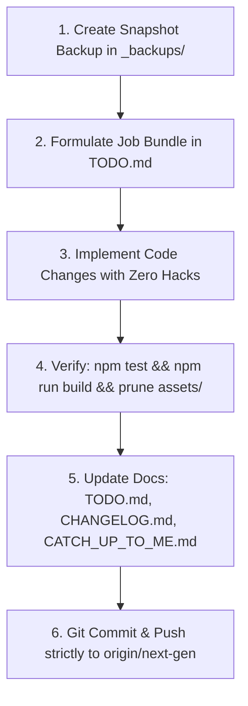

# CATCH UP TO ME: Operational Handover & Inter-Agent Transfer Protocol
*Little Flower Preparatory School (LFPS) Substitutions Manager & Master Routine Suite (Next-Gen v2.0)*

> **CRITICAL DIRECTIVE FOR THE INCOMING AI AGENT (READ THIS IN YOUR FIRST 30 SECONDS):**
> You are picking up work on this codebase because the user has switched accounts/sessions or opened a blank agent window due to quota limits. 
> This document is your comprehensive single source of truth. It details **everything done, why, where, when, and how**, along with exact instructions on how to behave, communicate, and code.

---

## ⚡ SECTION 0: ZERO-FRICTION FIRST-TURN HANDOVER & IMMEDIATE ACTION PLAN

### 1. Where You Are Right Now
- **Current Branch**: `next-gen` (Clean working tree, tracking `origin/next-gen`).
- **Unit Tests Status**: **18/18 passing** via `npm test`.
- **Production Build Status**: Passes cleanly via `npm run build`.
- **Live Deployment**: `https://steph1420.github.io/LFPS_Substitutions_Manager/` (tracks branch `next-gen`).

### 2. What Was Just Completed (Job Bundle 30)
- **Whole-Day Off. CT Domain Alignment & Clean Period Substitutions**: Officiating Class Teacher (`Off. CT`) is anchored as a whole-day class responsibility for parent communication, attendance, and administrative duties. Teaching periods are substituted by subject specialists without misleading period-level `• CT` stamps.
- **Scoped Teacher Self-Service Acceptance / Dispute**: `[ ✓ Accept ]` and `[ ⚑ Dispute ]` actions appear strictly for authenticated staff viewing their own assigned duties. Unauthenticated coordinators view clean status pills (`Assigned`, `✓ Accepted`, `⚑ Disputed`) with administrative controls.
- **Staff Roster Tab Bar Glow Removal**: Completely eliminated `isUrgent` and amber text from the Staff Roster navigation tab.
- **Role Hierarchy & Alphabetical Faculty Sorting**: Implemented 5-tier role hierarchy sorting (`Academic Coordinator` -> `Assistant Academic Coordinator` -> `Class Teachers` -> `2nd Teachers` -> `Other Staff`) and alphabetical ordering across both `RoutineGrid.tsx` and `AbsenceRoster.tsx` with a clean segmented toggle.
- **Zero-Shift Full Name Overlay Component (`TeacherNameOverlay.tsx`)**: Displays abbreviated names in static flow with zero layout reflow, while instantly revealing the full name directly over the abbreviation on desktop hover or mobile touch with outside-tap dismissal.
- **Off. CT Assign Pill Reordering**: Placed the Off. CT and Off. AC appointment pills directly above the attendance toggle button on teacher roster cards.

### 3. What To Do On Your Very First Turn
- If the user says **"Go"**, **"Yes"**, or tells you to proceed, **DO NOT ASK WHAT TO DO**. They are approving:
  👉 **Job Bundle 31: Theme Engine, Restored Developer Options & Routine Drag Reordering**:
  1. **`FEAT-46`**: Complete 12-Theme Engine Adapted from THEMES.md across 4 design families with visual swatches.
  2. **`FEAT-47`**: Restored Developer Options & Diagnostics Panel (5-tap version easter egg unlock; cross-period lock, target cell halo pulse indicator, etc.).
  3. **`FEAT-37A` & `FEAT-37B`**: Routine Matrix Drag-and-Drop Reordering with undo/redo and dedicated Class View context menu.
  4. **`FEAT-22`, `FEAT-23`, `FEAT-24`**: Substitutions Register column sorting chevrons and high-density adjustments.

### 4. Non-Negotiable Rules To Behave Like Me
1. **HIGH-CAPACITY COHESIVE BUNDLES**: The user instructed: *"Now we will not stick to just 2 tasks... You can make bundles as big as you can handle in your reasoning."* Group related features and bugfixes into comprehensive, thematic bundles.
2. **BRANCH SAFETY: WORK ONLY ON `next-gen`**: **NEVER TOUCH `main`**.
3. **PRE-BUNDLE SNAPSHOT BACKUP**: Run `tar -czf _backups/LFPS_Substitutions_Manager_v2.0.0_<bundle>_$(date +%Y%m%d_%H%M%S).tar.gz --exclude="node_modules" --exclude=".git" --exclude="dist" --exclude="_backups" .` before touching code.
4. **PRUNE STALE ASSETS AFTER BUILD**: When running `npm run build`, delete previous hashed files in `assets/` so only active bundles remain.
5. **CONFIRM BEFORE CODING**: If the user asks a question or reports an issue, confirm your exact understanding first before modifying files.
6. **COMMUNICATION STYLE**: Keep responses concise, format in GitHub markdown, and always create clickable file links using `file:///absolute/path` syntax.

---

## 1. Project Identity & Active Topology

- **Project Name**: Little Flower Preparatory School (LFPS) Substitutions Manager & Routine Matrix
- **Current Version**: `v2.0.0-alpha.1` (Next-Gen Monorepo)
- **Active Git Branch**: `next-gen` (Tracking `origin/next-gen`)
- **Live GitHub Pages URL**: `https://steph1420.github.io/LFPS_Substitutions_Manager/`
- **Live Go Cloud API**: `https://lfps-substitutions-manager.onrender.com` (Go 1.23 WebSocket Hub & Excel Export Engine)
- **Repository Architecture**: NPM Workspaces Monorepo:
  - [`packages/core`](file:///Users/steve/BigFolder/Edit&Prod/Scripting/School/LFPS_Substitutions_Manager/packages/core): Pure TypeScript domain engine, solver, types, seed data, and disambiguation. (100% test coverage via Vitest).
  - [`packages/ui`](file:///Users/steve/BigFolder/Edit&Prod/Scripting/School/LFPS_Substitutions_Manager/packages/ui): Apple HIG design tokens, spring physics curves, glass presets, and semantic color roles.
  - [`apps/web`](file:///Users/steve/BigFolder/Edit&Prod/Scripting/School/LFPS_Substitutions_Manager/apps/web): React 19 + TypeScript + Vite 6 + Tailwind CSS v4 + Framer Motion high-density PWA.
  - [`apps/server`](file:///Users/steve/BigFolder/Edit&Prod/Scripting/School/LFPS_Substitutions_Manager/apps/server): Go 1.23 high-concurrency microservice with Gorilla WebSocket hub and Excelize v2 export engine.
  - [`_backups/`](file:///Users/steve/BigFolder/Edit&Prod/Scripting/School/LFPS_Substitutions_Manager/_backups): Dated `.tar.gz` snapshots before major bundle milestones.

---

## 2. Instructions for the Incoming Agent: How to Maintain This File & Project Docs

To ensure zero cognitive leakage when switching between AI instances or user accounts, follow this strict protocol:

### 2.1 The Five Pillars of Documentation

Whenever you touch the codebase, you must keep five documentation files synchronized:

1. **`CATCH_UP_TO_ME.md` (This File)**:
   - Log every completed user request and job bundle under Section 3 ("Chronological History of Work Completed").
   - Record: **What** was changed, **Why** it was necessary, **Where** (file paths and line numbers), **When** (timestamp/commit hash), and **How** it was resolved.
   - Update Section 5 ("Current Workspace State & Next Up Backlog") with active tasks.

2. **`TODO.md`**:
   - Number every new feature or bug cluster as a **Job Bundle** (e.g. Job Bundle 22, Job Bundle 23).
   - Use standardized task codes: `BUG-XX` (bug fixes), `FEAT-XX` (features), `PERF-XX` (performance).
   - Mark completed items with `[x]` and update the bundle status from `🟡 In Progress` to `🟢 Resolved`.

3. **`CHANGELOG.md`**:
   - Follow the [Keep a Changelog](https://keepachangelog.com/) standard under the active version `[v2.0.0-alpha.1]`.
   - Categorize entries into `### Added`, `### Changed`, `### Fixed`, or `### Performance`.

4. **`ARCHITECTURE.md`**:
   - If you introduce a new package, modify the WebSocket protocol, alter data contracts, or add a state store slice, update the system topology and Mermaid diagrams in `ARCHITECTURE.md`.

5. **`DESIGN_PHILOSOPHY.md`**:
   - Consult this file before making any UI, animation, or UX decisions. Maintain Apple HIG tactile standards: spring physics over linear transitions, zero travel distance, non-blocking front-desk velocity.

### 2.2 The 6-Step Agent Execution Cycle

For every task requested by the user:



1. **Snapshot Backup**:
   ```bash
   tar -czf _backups/LFPS_Substitutions_Manager_v2.0.0_<label>_$(date +%Y%m%d_%H%M%S).tar.gz --exclude="node_modules" --exclude=".git" --exclude="dist" --exclude="_backups" .
   ```
2. **Bundle Formulation**: Propose the work items as a numbered bundle in `TODO.md` before execution.
3. **Clean Implementation**: Avoid quick hacks. Separate core domain logic into `@lfps/core` and UI tokens into `@lfps/ui`.
4. **Verification**:
   - Run Vitest tests: `npm test`
   - Build production bundle: `npm run build`
   - Remove stale `.js` and `.css` files from `assets/` so GitHub Pages only serves active hashes.
5. **Sync Docs**: Update `TODO.md`, `CHANGELOG.md`, and append to `CATCH_UP_TO_ME.md`.
6. **Git Push**:
   ```bash
   git add -A
   git commit -m "feat/fix(...): description"
   git push origin next-gen
   ```

---

## 3. Chronological History of Everything Done (What, Why, Where, When, How)

### Milestone 1: Next-Gen Monorepo Migration & Pure Core Solver (`acc67c0`)
- **When**: 2026-10-17
- **Why**: The legacy project was a monolithic single-file HTML/JS app (`index.html` > 4,000 lines) with accumulated bugs, fragile DOM string manipulation, lack of tests, and severe performance bottlenecks.
- **Where**:
  - Created [`packages/core/`](file:///Users/steve/BigFolder/Edit&Prod/Scripting/School/LFPS_Substitutions_Manager/packages/core): Domain types ([`types/index.ts`](file:///Users/steve/BigFolder/Edit&Prod/Scripting/School/LFPS_Substitutions_Manager/packages/core/src/types/index.ts)), master seed timetable data ([`data/seed.ts`](file:///Users/steve/BigFolder/Edit&Prod/Scripting/School/LFPS_Substitutions_Manager/packages/core/src/data/seed.ts)), disambiguation helper ([`disambiguation/index.ts`](file:///Users/steve/BigFolder/Edit&Prod/Scripting/School/LFPS_Substitutions_Manager/packages/core/src/disambiguation/index.ts)), and deterministic substitution solver ([`solver/index.ts`](file:///Users/steve/BigFolder/Edit&Prod/Scripting/School/LFPS_Substitutions_Manager/packages/core/src/solver/index.ts)).
  - Created [`packages/ui/`](file:///Users/steve/BigFolder/Edit&Prod/Scripting/School/LFPS_Substitutions_Manager/packages/ui): Apple HIG spring tokens and semantic role palettes.
  - Created [`apps/web/`](file:///Users/steve/BigFolder/Edit&Prod/Scripting/School/LFPS_Substitutions_Manager/apps/web): Modern React 19 + TypeScript + Tailwind CSS application.
  - Created [`apps/server/`](file:///Users/steve/BigFolder/Edit&Prod/Scripting/School/LFPS_Substitutions_Manager/apps/server): Go 1.23 WebSocket Hub and Excelize v2 exporter.
- **How**: Built pure TypeScript domain logic with zero DOM dependencies and backed it with a 10-test Vitest suite covering cell parsing, disambiguation, candidate ranking, and auto-resolve.

---

### Milestone 2: Dynamic Island Day Bar & Symmetrical Spring Physics (`ef9cb95` $\to$ `e2d2730`)
- **When**: 2026-10-18 01:50 – 02:05 IST
- **Why**: The user wanted the top header to hide when scrolling down, morphing the day selector into an iOS-style "Dynamic Island" floating capsule at the top of the viewport. Tapping the capsule expands it into the full day selector; tapping outside collapses it.
- **Where**:
  - [`apps/web/src/components/Header.tsx`](file:///Users/steve/BigFolder/Edit&Prod/Scripting/School/LFPS_Substitutions_Manager/apps/web/src/components/Header.tsx)
- **How**:
  - Implemented `layoutId="dynamic-island-day-bar"` with Framer Motion.
  - Used symmetrical spring physics: `ISLAND_SPRING = { type: 'spring', duration: 0.6, bounce: 0.12 }` ensuring expand and collapse animations have equal timing and weight.
  - Added full-screen backdrop (`fixed inset-0 z-40 bg-black/40 backdrop-blur-[2px]`) so tapping anywhere outside instantly collapses the island.
  - Added relaxed 4.8s auto-collapse countdown when a day is tapped.
  - Pre-highlighted the selected day pill in blue from frame 1 to eliminate visual sliding glitches upon expansion.

---

### Milestone 3: Tab System Partitioning & Vertical Workstations (`b67e194`)
- **When**: 2026-10-18 02:26 IST
- **Why**: Vertically stacking the Routine Grid, Absence Roster, and Substitutions Register on mobile forced users to scroll past hundreds of pixels to reach the master routine. Furthermore, the absence roster was a cramped horizontal tray.
- **Where**:
  - Created [`apps/web/src/components/TabBar.tsx`](file:///Users/steve/BigFolder/Edit&Prod/Scripting/School/LFPS_Substitutions_Manager/apps/web/src/components/TabBar.tsx): Apple HIG floating dock at the bottom of the viewport with live badge counts (amber for uncovered slots, rose for absent teachers) and keyboard shortcuts (`1`, `2`, `3`).
  - Modified [`apps/web/src/App.tsx`](file:///Users/steve/BigFolder/Edit&Prod/Scripting/School/LFPS_Substitutions_Manager/apps/web/src/App.tsx): Partitioned layout into 3 dedicated views (`routine`, `substitutions`, `roster`).
  - Refactored [`apps/web/src/components/AbsenceRoster.tsx`](file:///Users/steve/BigFolder/Edit&Prod/Scripting/School/LFPS_Substitutions_Manager/apps/web/src/components/AbsenceRoster.tsx): Upgraded to a dedicated vertical staff workstation with operational hierarchy sorting:
    - **Academic Coordinator (AC)**: Mrs. R. Pahwa
    - **Assistant Academic Coordinator (AAC)**: Mrs. S. Lakra
    - **Class Teachers (CT)**: Mrs. M. Midha, Mrs. R. Narayan (Teal-bordered badges)
    - **Subject Teachers (ST)**: Ms. N. Horo, Ms. K. Sanga, Ms. P. Topno (Blue-bordered badges)
  - Refactored [`apps/web/src/components/SubstitutionsRegister.tsx`](file:///Users/steve/BigFolder/Edit&Prod/Scripting/School/LFPS_Substitutions_Manager/apps/web/src/components/SubstitutionsRegister.tsx): Reordered KPI cards to:
    1. **Covered Substitutions** (Green border)
    2. **Uncovered Slots** (Red border)
    3. **Officiating Staff** (Purple border)

---

### Milestone 4: Directional Hysteresis & Mobile Margin Reclamation (`98830b9`)
- **When**: 2026-10-18 02:42 IST
- **Why**:
  1. On mobile phones, partial scrolling caused the Header and Dynamic Island pill to flutter/glitch, fighting each other at the threshold.
  2. The routine table had excessive margins on mobile, making cells unnecessarily narrow.
- **Where**:
  - [`apps/web/src/components/Header.tsx`](file:///Users/steve/BigFolder/Edit&Prod/Scripting/School/LFPS_Substitutions_Manager/apps/web/src/components/Header.tsx#L120-L150)
  - [`apps/web/src/App.tsx`](file:///Users/steve/BigFolder/Edit&Prod/Scripting/School/LFPS_Substitutions_Manager/apps/web/src/App.tsx#L23)
  - [`apps/web/src/components/RoutineGrid.tsx`](file:///Users/steve/BigFolder/Edit&Prod/Scripting/School/LFPS_Substitutions_Manager/apps/web/src/components/RoutineGrid.tsx#L65-L72)
- **How**:
  - Implemented directional hysteresis accumulator (`deltaThreshold = 25px`) with a 400ms transition lock ref (`isTransitioningRef`), preventing state oscillations.
  - Reclaimed 45px+ of mobile viewport width by reducing `<main>` padding to `px-1.5` on mobile.
  - Tightened table columns to `min-w-[80px]` (faculty) and `min-w-[78px]` (period cells) with stacked class/subject typography (`parseCellSlot`).

---

### Milestone 5: Job Bundle 22 — Routine Fullscreen Workstation Hardening & Tab Overview Collapse Controls (`d9504eb`)
- **When**: 2026-10-18 03:00 IST
- **Why**:
  1. **`BUG-10`**: Clicking "Expand Grid" resulted in a completely blank screen on mobile and desktop.
  2. **`FEAT-38` & `FEAT-39`**: Mobile users needed a way to collapse the top overview panels (KPI statistics strips) in both the Substitutions and Staff Roster tabs to maximize vertical reading space.
- **Where**:
  - [`apps/web/src/App.tsx`](file:///Users/steve/BigFolder/Edit&Prod/Scripting/School/LFPS_Substitutions_Manager/apps/web/src/App.tsx#L17-L29)
  - [`apps/web/src/components/RoutineGrid.tsx`](file:///Users/steve/BigFolder/Edit&Prod/Scripting/School/LFPS_Substitutions_Manager/apps/web/src/components/RoutineGrid.tsx#L296-L379)
  - [`apps/web/src/components/SubstitutionsRegister.tsx`](file:///Users/steve/BigFolder/Edit&Prod/Scripting/School/LFPS_Substitutions_Manager/apps/web/src/components/SubstitutionsRegister.tsx#L130-L190)
  - [`apps/web/src/components/AbsenceRoster.tsx`](file:///Users/steve/BigFolder/Edit&Prod/Scripting/School/LFPS_Substitutions_Manager/apps/web/src/components/AbsenceRoster.tsx#L110-L170)
- **How**:
  - **`BUG-10` Root Architecture Fix**: 
    - The previous implementation used `createPortal(..., document.body)` inside a child component while `document.body.style.overflow = 'hidden'` was set. In mobile WebKit, parent transforms and overflow mutations collapsed the flex container height to 0px.
    - Solution: Hoisted Fullscreen Workstation rendering directly to the root in `App.tsx`:
      ```tsx
      if (isFitGrid) {
        return (
          <div className="fixed inset-0 h-screen h-[100dvh] w-screen bg-slate-950 flex flex-col p-2.5 sm:p-4 overflow-hidden z-[100] select-none">
            <RoutineGrid isFullscreen />
            <MicroContextMenu />
            <SubAvailabilityModal />
            <CoTeacherModal />
            <OfficiatingModal />
          </div>
        );
      }
      ```
    - In `RoutineGrid.tsx`, set the table wrapper to `flex-1 min-h-0 w-full overflow-auto`. Table renders with 100% reliability, zero containing block clipping, and pinned headers.
    - Added direct **MON · TUE · WED · THU · FRI · SAT** day selector pills right inside the fullscreen toolbar alongside the dual Teachers/Classes toggle and <kbd>Esc</kbd> dismissal.
  - **`FEAT-38` (Substitutions Tab Overview Collapse)**:
    - Added tactile toggle button `[ ▾ Collapse Overview ]` $\longleftrightarrow$ `[ ▸ Show Overview ]` to the header.
    - Wrapped the 3 KPI cards (Covered, Uncovered, Officiating Staff) in Framer Motion `<AnimatePresence>` with spring height animation (`duration: 0.22`), reclaiming ~140px on mobile while keeping search/filter pills accessible.
  - **`FEAT-39` (Staff Roster Tab Overview Collapse)**:
    - Added tactile toggle button `[ ▾ Collapse Overview ]` $\longleftrightarrow$ `[ ▸ Show Overview ]` to the header.
    - Wrapped the 4 attendance KPI cards in `<AnimatePresence>`, reclaiming ~160px+ of vertical space so staff cards are immediately visible.

### Milestone 6: Interactive Settings Console, Per-Tab Undo/Redo Engine & Global Reset Controls (Job Bundle 23)
- **When**: 2026-10-18
- **Why**:
  1. The header settings button only toggled `isMinimalUI` with no visual console or mobile entrypoint (`BUG-11`).
  2. The user required independent undo/redo functionality for each of the three tabs (Routine, Substitutions, Roster) without cross-tab state pollution (`FEAT-40`).
  3. The user requested a safe global reset button with undo support, plus a 500ms long-press / right-click action to purge all undo/redo history buffers across all tabs (`FEAT-41`).
- **Where**:
  - [`apps/web/src/store/useTimetableStore.ts`](file:///Users/steve/BigFolder/Edit&Prod/Scripting/School/LFPS_Substitutions_Manager/apps/web/src/store/useTimetableStore.ts): Added isolated `HistoryStack<T>` for `routineHistory`, `substitutionsHistory`, `rosterHistory`. Pushed undo snapshots to all mutating actions capped at 30 FIFO entries. Added `undo(tab)`, `redo(tab)`, `canUndo(tab)`, `canRedo(tab)`, `resetDay(day)`, `purgeHistory()`, and `isSettingsOpen` controls.
  - [`apps/web/src/components/SettingsModal.tsx`](file:///Users/steve/BigFolder/Edit&Prod/Scripting/School/LFPS_Substitutions_Manager/apps/web/src/components/SettingsModal.tsx): Created Apple HIG settings console with 5 grouped sections (Operating Identity / Staff login, Interface & GPU status, Live Cloud Sync & diagnostics, Data Management / Excel Export / Reset Day / Purge Buffers, About & version info).
  - [`apps/web/src/components/ResetDayButton.tsx`](file:///Users/steve/BigFolder/Edit&Prod/Scripting/School/LFPS_Substitutions_Manager/apps/web/src/components/ResetDayButton.tsx): Created tactile header reset button with single-click reset and 500ms long-press / right-click context menu to purge all undo/redo history.
  - [`apps/web/src/components/UndoRedoControls.tsx`](file:///Users/steve/BigFolder/Edit&Prod/Scripting/School/LFPS_Substitutions_Manager/apps/web/src/components/UndoRedoControls.tsx): Created reusable toolbar button pair (`[ ↶ Undo ]` / `[ ↷ Redo ]`) with live disabled state.
  - [`apps/web/src/components/Header.tsx`](file:///Users/steve/BigFolder/Edit&Prod/Scripting/School/LFPS_Substitutions_Manager/apps/web/src/components/Header.tsx): Integrated `ResetDayButton` and settings modal trigger for both desktop and mobile viewports.
  - [`apps/web/src/App.tsx`](file:///Users/steve/BigFolder/Edit&Prod/Scripting/School/LFPS_Substitutions_Manager/apps/web/src/App.tsx): Mounted `<SettingsModal />` and registered global `⌘Z` / `⌘⇧Z` / `Ctrl+Y` keyboard listener scoped dynamically to the active tab.
  - [`apps/web/src/components/RoutineGrid.tsx`](file:///Users/steve/BigFolder/Edit&Prod/Scripting/School/LFPS_Substitutions_Manager/apps/web/src/components/RoutineGrid.tsx), [`apps/web/src/components/SubstitutionsRegister.tsx`](file:///Users/steve/BigFolder/Edit&Prod/Scripting/School/LFPS_Substitutions_Manager/apps/web/src/components/SubstitutionsRegister.tsx), [`apps/web/src/components/AbsenceRoster.tsx`](file:///Users/steve/BigFolder/Edit&Prod/Scripting/School/LFPS_Substitutions_Manager/apps/web/src/components/AbsenceRoster.tsx): Embedded `<UndoRedoControls />` on each tab's toolbar.
- **How**:
  - Independent slices: each tab's history only captures the state belonging to that slice, ensuring undoing a substitution does not alter staff attendance marks or routine schedule.
  - `resetDay` captures an undo snapshot before clearing data, making accidental resets immediately undoable via `⌘Z` or the Undo button.
  - History purge popover provides safe confirmation before clearing past/future arrays.

### Milestone 7: Tactile Front-Desk Polish, Root Modals & Manual Sub Workflow (Job Bundle 24)
- **When**: 2026-10-18
- **Why**:
  1. Marking an absent teacher back to present left orphan substitutions active in the timetable (`BUG-12`).
  2. Right-clicking or long-pressing routine instructional cells mirrored the teacher absence context menu, blocking gesture freedom (`BUG-13`).
  3. Modals and menus (`StaffLoginModal`, `ResetPurgeContextMenu`) were nested inside transformed headers/buttons, creating CSS local containing block collisions that trapped or clipped popovers (`BUG-14`, `BUG-15`).
  4. Tab overview accordion collapse animation was jerky due to subpixel layout reflow jitter (`BUG-16`).
  5. `Away (Official)` staff needed to be counted and filtered under 'Free' in attendance roster metrics (`LOGIC-01`).
  6. Universal outside-click and <kbd>Escape</kbd> dismissal was required across all floating elements (`LOGIC-02`).
  7. Co-teachers in joint classes had asymmetric styling (`LOGIC-03`).
  8. Uncovered slots needed an interactive 1-tap substitute assignment modal (`FEAT-42`).
  9. Substitutions KPI cards needed reordering (1st Covered [green border], 2nd Uncovered [red border], 3rd Officiating Staff) (`FEAT-43`).
  10. Overview collapse ergonomics required a rightmost-aligned icon button and empty header space tap trigger (`FEAT-44`).
- **Where**:
  - [`packages/core/src/solver/index.ts`](file:///Users/steve/BigFolder/Edit&Prod/Scripting/School/LFPS_Substitutions_Manager/packages/core/src/solver/index.ts): Added `extractClassSections`, `areTeachersCoTeachingPartners`, and `isTeacherCoTeachingInSlot` (`LOGIC-03`). Passed 11/11 Vitest tests in `packages/core/test/solver.test.ts`.
  - [`apps/web/src/store/useTimetableStore.ts`](file:///Users/steve/BigFolder/Edit&Prod/Scripting/School/LFPS_Substitutions_Manager/apps/web/src/store/useTimetableStore.ts): In `toggleAbsence`, automatically scans and purges all substitutions involving the teacher when untoggling absence (`BUG-12`). Added store slice for `isStaffLoginOpen`, `activeResetPurgeMenu`, and `activeAssignSubSlot`.
  - [`apps/web/src/components/StaffLoginModal.tsx`](file:///Users/steve/BigFolder/Edit&Prod/Scripting/School/LFPS_Substitutions_Manager/apps/web/src/components/StaffLoginModal.tsx): Created standalone root modal resolving `BUG-14`.
  - [`apps/web/src/components/ResetPurgeContextMenu.tsx`](file:///Users/steve/BigFolder/Edit&Prod/Scripting/School/LFPS_Substitutions_Manager/apps/web/src/components/ResetPurgeContextMenu.tsx): Created standalone root context menu with screen-space edge clamping resolving `BUG-15`.
  - [`apps/web/src/components/AssignSubstituteModal.tsx`](file:///Users/steve/BigFolder/Edit&Prod/Scripting/School/LFPS_Substitutions_Manager/apps/web/src/components/AssignSubstituteModal.tsx): Created candidate substitute selection drawer ranking candidates using `findAvailableSubstitutes` (`FEAT-42`).
  - [`apps/web/src/components/RoutineGrid.tsx`](file:///Users/steve/BigFolder/Edit&Prod/Scripting/School/LFPS_Substitutions_Manager/apps/web/src/components/RoutineGrid.tsx): Scoped `MicroContextMenu` strictly to teacher column (`BUG-13`); applied `isTeacherCoTeachingInSlot` for co-teacher visual parity (`LOGIC-03`).
  - [`apps/web/src/components/AbsenceRoster.tsx`](file:///Users/steve/BigFolder/Edit&Prod/Scripting/School/LFPS_Substitutions_Manager/apps/web/src/components/AbsenceRoster.tsx): Categorized `Away (Official)` under 'Free' (`LOGIC-01`), rightmost collapse icon and header free space trigger (`FEAT-44`), smooth spring easing with `SPRING_TRANSITIONS.snappy` (`BUG-16`).
  - [`apps/web/src/components/SubstitutionsRegister.tsx`](file:///Users/steve/BigFolder/Edit&Prod/Scripting/School/LFPS_Substitutions_Manager/apps/web/src/components/SubstitutionsRegister.tsx): Reordered KPI cards to Covered (green border) -> Uncovered (red border) -> Officiating Staff (`FEAT-43`); added 1-tap `[ Assign Substitute ]` trigger on uncovered cards (`FEAT-42`); smooth spring easing and header ergonomics (`FEAT-44`, `BUG-16`).
  - [`apps/web/src/App.tsx`](file:///Users/steve/BigFolder/Edit&Prod/Scripting/School/LFPS_Substitutions_Manager/apps/web/src/App.tsx): Mounted `<StaffLoginModal />`, `<ResetPurgeContextMenu />`, and `<AssignSubstituteModal />` at root in both fullscreen and normal modes.
- **How**:
  - Elimination of CSS transform containing block traps: Modals and context menus rendered at root level in `App.tsx` are immune to ancestor CSS transforms (`will-change-transform`, `translate3d`).
  - Buttery 120fps GPU accordion collapse: Outer animating container uses `overflow-hidden will-change-[height,opacity]`, with inner padding isolated to child containers to prevent subpixel jumping.
  - Universal outside-click and <kbd>Escape</kbd> dismissal across all modals and popovers (`LOGIC-02`).

### Milestone 8: Tactical Matrix Ergonomics, Header Peek Navigation & Golden CT Tokens (Job Bundle 25)
- **When**: 2026-10-18
- **Why**:
  1. Scrolling down on mobile hid the entire header, making it cumbersome to reach Reset Day, Settings, or Login without scrolling all the way back up (`FEAT-52`).
  2. The mobile browser address bar expansion/collapse fought with custom header animation, creating a jerky double jump on Chromium, Safari, Firefox, Opera, and Edge (`FEAT-57`).
  3. On narrow screens, wide sticky teacher name columns squished the instructional period columns, impairing readability (`FEAT-53`).
  4. Absent teachers in the routine matrix were difficult to spot at a glance during morning reviews (`FEAT-54`).
  5. Front desk staff needed an option to hide absent teachers to focus on present faculty (`FEAT-55`).
  6. Class Teachers needed distinct Golden/Amber role color coding (`#f59e0b`) instead of Teal, while preserving Royal Violet (`#8b5cf6`) for Academic Coordinators (`FEAT-56`).
  7. Substitutions and Roster workstations lacked List vs Grid view modes and multi-criteria sorting (`FEAT-58`).
  8. Missing "Add to Home Screen" PWA install button and Apple-grade iOS Safari guidance (`FEAT-59`).
  9. User view preferences were lost on reload and lacked an explicit Save / Reset mechanism (`FEAT-60`).
  10. Minimal UI Mode had no visual effect on component density (`BUG-17`).
  11. Settings needed a preference toggle to collapse tab overviews by default on startup (`FEAT-45`).
- **Where**:
  - [`packages/ui/src/tokens.ts`](file:///Users/steve/BigFolder/Edit&Prod/Scripting/School/LFPS_Substitutions_Manager/packages/ui/src/tokens.ts): Updated `COLOR_ROLES.classTeacher` base to `#f59e0b` (Golden Amber) with dark text `#fbbf24` and matching bg/border (`FEAT-56`).
  - [`apps/web/src/store/useTimetableStore.ts`](file:///Users/steve/BigFolder/Edit&Prod/Scripting/School/LFPS_Substitutions_Manager/apps/web/src/store/useTimetableStore.ts): Added `hideOverviewsByDefault`, `hideAbsentStaff`, `substitutionsViewMode`, `rosterViewMode`, `substitutionsSortBy`, `rosterSortBy` to store state with auto-persistence and explicit `savePreferences()` and `resetPreferences()` (`FEAT-45`, `FEAT-55`, `FEAT-58`, `FEAT-60`).
  - [`apps/web/src/components/Header.tsx`](file:///Users/steve/BigFolder/Edit&Prod/Scripting/School/LFPS_Substitutions_Manager/apps/web/src/components/Header.tsx): Implemented Peek Header Console (`isPeekMode = currentScrollY > 50`) providing instant access to Reset Day, Settings, PWA Install, Excel, and Staff Login; added `window.visualViewport` resize listener with hysteresis to eliminate mobile address-bar double jump (`FEAT-52`, `FEAT-57`, `FEAT-59`).
  - [`apps/web/src/components/AddToHomeScreenModal.tsx`](file:///Users/steve/BigFolder/Edit&Prod/Scripting/School/LFPS_Substitutions_Manager/apps/web/src/components/AddToHomeScreenModal.tsx): Created standalone PWA installation and iOS Safari 3-step walkthrough modal (`FEAT-59`).
  - [`apps/web/src/components/RoutineGrid.tsx`](file:///Users/steve/BigFolder/Edit&Prod/Scripting/School/LFPS_Substitutions_Manager/apps/web/src/components/RoutineGrid.tsx): Added horizontal scroll observer collapsing sticky column to ~64px with 2-line split font on narrow viewports (`FEAT-53`); highlighted absent teachers in bold crimson red (`bg-rose-950/90 border-r-2 border-r-rose-500 text-rose-200`) (`FEAT-54`); added "Hide Absent" interactive toggle button in controls toolbar (`FEAT-55`); styled Class Teachers with golden amber badges (`FEAT-56`); wired `isMinimalUI` density classes (`BUG-17`).
  - [`apps/web/src/components/AbsenceRoster.tsx`](file:///Users/steve/BigFolder/Edit&Prod/Scripting/School/LFPS_Substitutions_Manager/apps/web/src/components/AbsenceRoster.tsx): Implemented Grid (`[ ⊞ Grid ]`) and List (`[ ☰ List ]`) views; added sorting pills for Role Hierarchy vs Alphabetical Name (`FEAT-58`); updated CT badge to golden amber (`FEAT-56`); initialized `isOverviewCollapsed` with `hideOverviewsByDefault` (`FEAT-45`); wired `isMinimalUI` density classes (`BUG-17`).
  - [`apps/web/src/components/SubstitutionsRegister.tsx`](file:///Users/steve/BigFolder/Edit&Prod/Scripting/School/LFPS_Substitutions_Manager/apps/web/src/components/SubstitutionsRegister.tsx): Implemented Grid and List views with Period, Name, and Role sorting (`FEAT-58`); styled Class Teacher uncovered and covered cards with golden amber tokens (`FEAT-56`); initialized `isOverviewCollapsed` with `hideOverviewsByDefault` (`FEAT-45`); wired `isMinimalUI` density classes (`BUG-17`).
  - [`apps/web/src/components/SettingsModal.tsx`](file:///Users/steve/BigFolder/Edit&Prod/Scripting/School/LFPS_Substitutions_Manager/apps/web/src/components/SettingsModal.tsx): Added toggles for "Minimal UI Mode", "Hide Overviews by Default", and "Hide Absent Teachers in Routine Matrix"; added "Save Preferences" and "Reset Defaults" actions (`FEAT-60`); integrated "Add to Home Screen / Install App" trigger (`FEAT-59`).
  - [`apps/web/src/components/TabBar.tsx`](file:///Users/steve/BigFolder/Edit&Prod/Scripting/School/LFPS_Substitutions_Manager/apps/web/src/components/TabBar.tsx): Wired `isMinimalUI` density padding (`BUG-17`).
- **How**:
  - `splitTeacherName` utility parses teacher initials and surname into clean 2-line stacked badges on horizontal scroll.
  - Viewport-aware scroll synchronization suppresses scroll delta accumulation when `visualViewport` height changes during mobile URL bar expansion/collapse.
  - Automatic `localStorage` preferences persistence with explicit UI control prevents state desynchronization across sessions.

### 3.12 Job Bundle 26A: Leadership Chain of Command, Dedicated CT Auto-Resolve & Attention Pulse (2026-10-18)
- **Status**: 🟢 Resolved & Merged (Max 2 items constraint)
- **What**:
  1. `LOGIC-04` (Academic Coordinator Succession & Officiating Workflow):
     - Automatic chain of command: When Academic Coordinator (`Mrs. R. Pahwa`) is marked absent, the Assistant Academic Coordinator (`Mrs. S. Lakra`, AAC) automatically acts on her behalf as Officiating AC (`Off. AC`).
     - Only if BOTH the AC and AAC are absent does the system require appointing a 3rd-party Officiating AC (`needsAppointment: true`).
     - When appointment is needed, flashes both the **Substitutions** and **Staff Roster** navigation tabs with a soft pulsing amber halo (`@keyframes softAmberAttention` / `attention-pulse`).
     - Surfaced dedicated Officiating AC prompt card in `SubstitutionsRegister.tsx` with 1-tap manual designation (`openOfficiatingModal({ type: 'AC' })`).
     - In `AbsenceRoster.tsx`, dynamically indicates `Mrs. S. Lakra (Acting for Mrs. R. Pahwa)` on duty.
  2. `LOGIC-05` (Dedicated Class Teacher Auto-Resolve & Golden Substitution Cards):
     - In `SubstitutionsRegister.tsx`, added dedicated `[ ⚡ Auto-Resolve CT (X Slots) ]` button next to the standard solver button that filters uncovered periods strictly to absent Class Teachers.
     - Rendered all Class Teacher substitution cards in both Grid Card View and List View with an eye-catching golden aesthetic (`border-amber-500/60 bg-gradient-to-br from-amber-950/35 via-slate-900/95 to-amber-900/25 ring-1 ring-amber-500/40 text-amber-200`).
     - When any Class Teacher has uncovered class periods, flashes both the **Substitutions** and **Staff Roster** tabs with the soft pulsing amber glow until coverage is complete.
- **Where**:
  - [`packages/core/src/types/index.ts`](file:///Users/steve/BigFolder/Edit&Prod/Scripting/School/LFPS_Substitutions_Manager/packages/core/src/types/index.ts): Defined `EffectiveOfficiatingACResult` interface.
  - [`packages/core/src/solver/index.ts`](file:///Users/steve/BigFolder/Edit&Prod/Scripting/School/LFPS_Substitutions_Manager/packages/core/src/solver/index.ts): Implemented `getEffectiveOfficiatingAC(day, absences, officiatingACMap)` domain algorithm.
  - [`packages/core/test/solver.test.ts`](file:///Users/steve/BigFolder/Edit&Prod/Scripting/School/LFPS_Substitutions_Manager/packages/core/test/solver.test.ts): Added 4 comprehensive Vitest test cases (retaining AC, auto-acting AAC, dual absence requirement, manual override); expanded suite to 15 passing tests.
  - [`apps/web/src/index.css`](file:///Users/steve/BigFolder/Edit&Prod/Scripting/School/LFPS_Substitutions_Manager/apps/web/src/index.css): Added `@keyframes softAmberAttention` and `.attention-pulse` classes.
  - [`apps/web/src/components/TabBar.tsx`](file:///Users/steve/BigFolder/Edit&Prod/Scripting/School/LFPS_Substitutions_Manager/apps/web/src/components/TabBar.tsx): Integrated live evaluation of `needsOffACAppointment` and `hasUncoveredCTSlots`, triggering `attention-pulse` on Substitutions and Roster tabs.
  - [`apps/web/src/components/SubstitutionsRegister.tsx`](file:///Users/steve/BigFolder/Edit&Prod/Scripting/School/LFPS_Substitutions_Manager/apps/web/src/components/SubstitutionsRegister.tsx): Added `[ ⚡ Auto-Resolve CT ]` solver button, Officiating AC Required action card, golden CT substitution styling in Grid and List modes, and succession badges in Officiating overview.
### 3.13 Job Bundle 26: Immediate Operational Polish, Nomenclature, Roster Ergonomics & Non-Shifting UI (2026-10-19)
- **Status**: 🟢 Resolved & Merged
- **What**:
  1. `BUG-19` (Officiating AC Persistence Fix on Mark Present / Mark All Present):
     - In `@lfps/core` `getEffectiveOfficiatingAC`: Primary AC (`Mrs. R. Pahwa`) takes absolute precedence when on duty (`!isAcAbsent`), ignoring stale manual entries in `officiatingACMap`.
     - In `useTimetableStore.ts`: Automatically prune and reconcile `officiatingAC[day]` when AC is untoggled present. Also implemented atomic `markAllPresent(day)` action that cleans up absences, substitutions, and officiating mappings in a single history snapshot.
     - Added comprehensive unit test in `packages/core/test/solver.test.ts` (16/16 Vitest tests passing).
  2. `LOGIC-07` (Routine Classes View: Remove Nursery Sections):
     - In `RoutineGrid.tsx`, removed `NUR A` and `NUR B` from `classSections`, strictly retaining active classes (`KG A`, `KG B`, `PREP A`, `PREP B`).
  3. `TERMS-01` & `TERMS-02` (Universal Nomenclature Cleanup: Eradicate 'Team' and 'Leader'):
     - Removed the word "Team" across all components, labels, and modals. Teachers in a class are strictly referred to as **Class Teacher** (CT) and **2nd Teacher** (2T), or **"part of a class"**.
     - Removed the word "Leader" / "Leadership" across all UI copy and code. Strictly use **"Officiating Staff"**, **"Officiating"**, **"Staff"**, or **"Teacher"**.
  4. `UI-01` & `UI-03` (Human School Overview Headings):
     - Substitutions tab: Renamed heading to **"Substitutions Overview ({selectedDay})"**.
     - Staff Roster tab: Renamed heading to **"Staff Roster Overview ({selectedDay})"**.
     - Officiating Section: Renamed to **"Officiating Staff ({selectedDay})"**.
  5. `UI-05` (Non-Shifting UI for Absence Actions):
     - Eliminated layout jumps and vertical push-downs when marking AC or CT absent by reserving stable action container slots (`min-h-[28px]`) and routing actions to the toolbar and Card 3.
  6. `LOGIC-06`, `UI-02` & `UI-04` (Staff Roster Card Ergonomics & Multi-Density Suite):
     - Entire card / row free-space tap toggles teacher attendance (`Mark Absent` ⟷ `Mark Present`), with child interactive buttons guarded by `e.stopPropagation()`.
     - Prioritized teacher full names (`teacher.fullName`) directly; abbreviations show on narrow viewports via responsive CSS.
     - 4 View Modes: **Comfort Grid** (spacious cards with chips), **Compact Grid** (high-density cards), **Compact List** (single-line spreadsheet table for 50+ staff), and **Detailed List** (expanded rows). Preferences auto-persist in `localStorage`.
- **Where**:
  - [`packages/core/src/solver/index.ts`](file:///Users/steve/BigFolder/Edit&Prod/Scripting/School/LFPS_Substitutions_Manager/packages/core/src/solver/index.ts)
  - [`packages/core/test/solver.test.ts`](file:///Users/steve/BigFolder/Edit&Prod/Scripting/School/LFPS_Substitutions_Manager/packages/core/test/solver.test.ts)
  - [`apps/web/src/store/useTimetableStore.ts`](file:///Users/steve/BigFolder/Edit&Prod/Scripting/School/LFPS_Substitutions_Manager/apps/web/src/store/useTimetableStore.ts)
  - [`apps/web/src/components/RoutineGrid.tsx`](file:///Users/steve/BigFolder/Edit&Prod/Scripting/School/LFPS_Substitutions_Manager/apps/web/src/components/RoutineGrid.tsx)
  - [`apps/web/src/components/OfficiatingModal.tsx`](file:///Users/steve/BigFolder/Edit&Prod/Scripting/School/LFPS_Substitutions_Manager/apps/web/src/components/OfficiatingModal.tsx)
  - [`apps/web/src/components/SubstitutionsRegister.tsx`](file:///Users/steve/BigFolder/Edit&Prod/Scripting/School/LFPS_Substitutions_Manager/apps/web/src/components/SubstitutionsRegister.tsx)
  - [`apps/web/src/components/AbsenceRoster.tsx`](file:///Users/steve/BigFolder/Edit&Prod/Scripting/School/LFPS_Substitutions_Manager/apps/web/src/components/AbsenceRoster.tsx)

### 3.14 Job Bundle 27: Mobile Scroll & 100dvh Sync, Human School Roles, Roster Ergonomics & Non-Distracting Officiating Flow (2026-10-19)
- **Status**: 🟢 Resolved & Merged
- **What**:
  1. `UI-06` (Vivid Red Absence Card Styling):
     - Roster teacher cards across all 4 modes (Normal Grid, Compact Grid, Normal List, Compact List) turn unmistakable, rich red (`bg-rose-950/70 border-rose-500 ring-1 ring-rose-500/40 text-rose-100`) with red status pills and avatars when marked absent, eliminating faint 20% opacity.
  2. `LOGIC-08` (Substitutions Page Officiating Purity):
     - Auto-acting AC (`Mrs. S. Lakra (Acting)`) is completely excluded from the Substitutions tab "Officiating Staff" section and KPI Card 3. Substitutions tab strictly displays manual appointments or required appointments.
  3. `UI-07` (Officiating Action Nomenclature & Amber Flash):
     - On Off. CT and Off. AC cards, renamed action button to `'Assign'` (if unappointed) and `'Reassign'` (if already appointed), replacing `'Change'`.
     - Cards needing/holding officiating appointment play a subtle 2-cycle amber glow (`.amber-look-at-me`) when switching to Staff Roster ("LOOK AT ME").
  4. `UI-08` (Tab Bar Alert Scoping):
     - Removed amber attention glow from 'Staff Roster' tab pill; scoped strictly to 'Substitutions' tab when slots remain pending.
  5. `PERF-02` (Mobile Header & 100dvh Synchronization):
     - Eliminated 250ms `isViewportResizing` lockout in `Header.tsx` that choked mobile scroll listeners.
     - Applied `100dvh` (Dynamic Viewport Height) across the main layout container in `App.tsx` and `index.html`.
  6. `UI-09` (Multi-Density Roster Labels):
     - Streamlined view modes to: Grid (Normal, Compact) and List (Normal, Compact).
  7. `ARCH-01` (Component Modularity / The Proven Architectural Strategy):
     - Decomposed `AbsenceRoster.tsx` monolith into clean, modular subcomponents in `apps/web/src/components/roster/`: `RosterNormalCard.tsx`, `RosterCompactCard.tsx`, `RosterNormalListRow.tsx`, and `RosterCompactListRow.tsx`, slashing file size to ~350 lines and saving substantial context quota for future runs.
- **Where**:
  - [`apps/web/src/components/AbsenceRoster.tsx`](file:///Users/steve/BigFolder/Edit&Prod/Scripting/School/LFPS_Substitutions_Manager/apps/web/src/components/AbsenceRoster.tsx)
  - [`apps/web/src/components/roster/RosterNormalCard.tsx`](file:///Users/steve/BigFolder/Edit&Prod/Scripting/School/LFPS_Substitutions_Manager/apps/web/src/components/roster/RosterNormalCard.tsx)
  - [`apps/web/src/components/roster/RosterCompactCard.tsx`](file:///Users/steve/BigFolder/Edit&Prod/Scripting/School/LFPS_Substitutions_Manager/apps/web/src/components/roster/RosterCompactCard.tsx)
  - [`apps/web/src/components/roster/RosterNormalListRow.tsx`](file:///Users/steve/BigFolder/Edit&Prod/Scripting/School/LFPS_Substitutions_Manager/apps/web/src/components/roster/RosterNormalListRow.tsx)
  - [`apps/web/src/components/roster/RosterCompactListRow.tsx`](file:///Users/steve/BigFolder/Edit&Prod/Scripting/School/LFPS_Substitutions_Manager/apps/web/src/components/roster/RosterCompactListRow.tsx)
  - [`apps/web/src/components/Header.tsx`](file:///Users/steve/BigFolder/Edit&Prod/Scripting/School/LFPS_Substitutions_Manager/apps/web/src/components/Header.tsx)
  - [`apps/web/src/components/TabBar.tsx`](file:///Users/steve/BigFolder/Edit&Prod/Scripting/School/LFPS_Substitutions_Manager/apps/web/src/components/TabBar.tsx)
  - [`apps/web/src/components/SubstitutionsRegister.tsx`](file:///Users/steve/BigFolder/Edit&Prod/Scripting/School/LFPS_Substitutions_Manager/apps/web/src/components/SubstitutionsRegister.tsx)
  - [`apps/web/src/store/useTimetableStore.ts`](file:///Users/steve/BigFolder/Edit&Prod/Scripting/School/LFPS_Substitutions_Manager/apps/web/src/store/useTimetableStore.ts)
  - [`apps/web/src/index.css`](file:///Users/steve/BigFolder/Edit&Prod/Scripting/School/LFPS_Substitutions_Manager/apps/web/src/index.css)
  - [`apps/web/src/App.tsx`](file:///Users/steve/BigFolder/Edit&Prod/Scripting/School/LFPS_Substitutions_Manager/apps/web/src/App.tsx)

### 3.15 Comprehensive Error & Bug Resolution Ledger (User-Reported Issues & Technical Solutions)

This section documents every error, complaint, and glitch the user reported on the v2 app, the root causes, and how they were resolved:

#### Issue 1: Header Flickering Glitch, Day Bar Collision & 4-State Scroll Behavior
- **User Complaint**: 
  > *"Big issue... Big big issue... Listen: At the top of the page, it stays full... elements are cluttered, the day bar is pushing the right icons off the screen. When we scroll down, the header should completely go away and the day bar should shrink to a pill... If I am far down and scroll up, only a thin strip should show... Day bar should stay like a pill. Only when scrolling hits the top, the full header should slide down and the day bar should join back inside the header... Flickering glitch is back in action. Also, the pill joins into the thin strip which I SAID not to. Pill should stay below the thin strip and only join the full header."*
- **Root Causes**:
  1. **Scroll Thrashing**: Rapid finger movements or scroll bounce near scroll threshold caused the component to alternate between `PEEK` and `HIDDEN` on every frame, generating severe visual flickering.
  2. **Interrupted Animation Cycles**: Framer Motion layout transitions were constantly canceled by new scroll listener events firing before the previous transition completed.
  3. **Pill-Strip Collision**: In an intermediate edit, the floating pill was rendered inside the thin peek strip or pinned at `top-2`, colliding with the title and action buttons.
- **The Exact Architectural Fix** ([`Header.tsx`](file:///Users/steve/BigFolder/Edit&Prod/Scripting/School/LFPS_Substitutions_Manager/apps/web/src/components/Header.tsx)):
  1. **Four Explicit Scroll States**:
     - `AT_TOP` (`scrollY <= 50`): Full header slides down. Day Bar docks **inside** the header DOM.
     - `SCROLLING_DOWN` (`scrollY > 50` and scrolling down): Header is completely hidden (`-translate-y-full`). Day Bar shrinks into a floating pill at `top-3`.
     - `SCROLLING_UP_PEEK` (`scrollY > 50` and scrolling up): A thin peek strip appears (`h-11` at `top-0`) showing strictly app title, Reset Day, and Settings icons. The Day Bar floats strictly **BELOW** the thin strip at `top-14` (56px) as an independent floating capsule. It is **NEVER** injected into the thin strip.
     - `RETURN_TO_TOP` (`scrollY <= 50`): Full header slides down, and the Day Bar joins back inside the header.
  2. **350ms Transition Lockout Ref**:
     ```ts
     isTransitioningRef.current = true;
     setTimeout(() => { isTransitioningRef.current = false; }, 350);
     ```
  3. **Directional Hysteresis Thresholds**:
     Requires `> 35px` accumulated downward scroll to trigger `HIDDEN` mode, and `<-40px` accumulated upward scroll to trigger `PEEK` mode. Prevents finger bounce from triggering state toggles.

---

#### Issue 2: Mobile Jerky Double-Jump (Browser Bar Synchronization)
- **User Complaint**:
  > *"In mobile, I have noticed when I scroll up, the browser bar hides first and then our header. Which creates a jerky adouble jump in ui. Need to sync header/peek/show with the browser - at least for major browsers (chromium, Firefox, opera, safari, edge)."*
- **Root Cause**:
  Mobile browsers (Safari, Chrome, Firefox, Opera, Edge) show and hide their own URL/navigation bar during scrolling, firing `window.visualViewport.resize` events that dynamically alter available viewport height while scroll events are simultaneously firing. The delta between viewport height changes and DOM scroll deltas caused the custom header animation to trigger out of phase with browser chrome.
- **The Exact Architectural Fix** ([`Header.tsx`](file:///Users/steve/BigFolder/Edit&Prod/Scripting/School/LFPS_Substitutions_Manager/apps/web/src/components/Header.tsx)):
  - Added a `window.visualViewport.addEventListener('resize', ...)` listener.
  - Tracked `lastViewportHeightRef.current`.
  - Whenever `Math.abs(currentHeight - lastHeight) > 10` is detected (browser address bar expanding or collapsing), immediately reset `deltaYAccumulator.current = 0`, suppressing phantom scroll delta accumulation and synchronizing header state transitions cleanly with browser chrome.

---

#### Issue 3: Narrow Screen Faculty Column Squishing Instructional Periods (`FEAT-53`)
- **User Complaint**:
  > *"UI: Make the teacher names panel collapsing upon horizontal scroll (narrow screens). Upon collapsing, use small thin font for names and split over two lines."*
- **Root Cause**:
  The sticky teacher name column was fixed at `min-w-[140px]`. On mobile devices with ~375px–414px total width, this left less than 240px for 6 period columns, forcing horizontal scrolling with squished text.
- **The Exact Architectural Fix** ([`RoutineGrid.tsx`](file:///Users/steve/BigFolder/Edit&Prod/Scripting/School/LFPS_Substitutions_Manager/apps/web/src/components/RoutineGrid.tsx)):
  - Added a horizontal scroll observer on the matrix container (`onScroll={(e) => setIsHorizontallyScrolled(e.currentTarget.scrollLeft > 20)}`).
  - When scrolled horizontally on narrow viewports (`< 768px`), the teacher column collapses from `min-w-[140px]` to `min-w-[64px]`.
  - Built `splitTeacherName(fullName)` helper that splits initials from surname (e.g. "SL" and "Lakra", "RP" and "Pahwa") and renders them stacked over two lines in a thin, elegant 10px font (`text-[10px] leading-tight font-medium text-slate-300`).

---

#### Issue 4: Absent Teachers Invisibility & Routine Filtering (`FEAT-54`, `FEAT-55`)
- **User Complaint**:
  > *"UI: For absent teachers, make their name cells in routine red. UI: Add option to hide teachers who are absent."*
- **The Exact Architectural Fix** ([`RoutineGrid.tsx`](file:///Users/steve/BigFolder/Edit&Prod/Scripting/School/LFPS_Substitutions_Manager/apps/web/src/components/RoutineGrid.tsx), [`useTimetableStore.ts`](file:///Users/steve/BigFolder/Edit&Prod/Scripting/School/LFPS_Substitutions_Manager/apps/web/src/store/useTimetableStore.ts)):
  - For any teacher marked absent on `selectedDay`, their sticky name cell in the Routine Matrix is highlighted in bold crimson red (`bg-rose-950/90 border-r-2 border-r-rose-500 text-rose-200 font-bold`).
  - Added `hideAbsentStaff: boolean` to the Zustand store with `toggleHideAbsentStaff()`.
  - Added a tactile filter toggle button in the Routine Grid toolbar (`[ 👁 Hide Absent ]` / `[ 👁 Show Absent ]`) and an explicit preference toggle in `SettingsModal.tsx`.

---

#### Issue 5: Class Teacher Role Color Coding (`FEAT-56`)
- **User Complaint**:
  > *"UI: Color code CT with golden instead of Teal. ACs, even if CT, will remain Purple or Pink whatever it is currently."*
- **The Exact Architectural Fix** ([`tokens.ts`](file:///Users/steve/BigFolder/Edit&Prod/Scripting/School/LFPS_Substitutions_Manager/packages/ui/src/tokens.ts), [`SubstitutionsRegister.tsx`](file:///Users/steve/BigFolder/Edit&Prod/Scripting/School/LFPS_Substitutions_Manager/apps/web/src/components/SubstitutionsRegister.tsx), [`AbsenceRoster.tsx`](file:///Users/steve/BigFolder/Edit&Prod/Scripting/School/LFPS_Substitutions_Manager/apps/web/src/components/AbsenceRoster.tsx)):
  - In `@lfps/ui`, upgraded `COLOR_ROLES.classTeacher` to Golden Amber:
    - Base: `#f59e0b` (Amber 500)
    - Dark text: `#fbbf24` (Amber 400)
    - Background: `rgba(245, 158, 11, 0.15)`
    - Border: `rgba(245, 158, 11, 0.4)`
  - Added hierarchy filter function:
    ```ts
    const isClassTeacher = (teacherName: string): boolean => {
      const teacher = directory[teacherName];
      if (!teacher) return false;
      const isAC = teacher.abbr === 'Mrs. R. Pahwa' || (teacher.role.includes('Academic Coordinator') && !teacher.role.includes('Asst.'));
      const isAAC = teacher.abbr === 'Mrs. S. Lakra' || teacher.role.includes('Asst. Academic Coordinator');
      return teacher.role.includes('Class Teacher') && !isAC && !isAAC;
    };
    ```
  - Academic Coordinators (`Mrs. R. Pahwa`, `Mrs. S. Lakra`) strictly retain Royal Violet / Purple tokens (`COLOR_ROLES.coordinator`).

---

#### Issue 6: Academic Coordinator Succession & Tab Attention Glow (`LOGIC-04`)
- **User Complaint**:
  > *"Logic: If AC is absent, AAC acts on their behalf. We can technically say they are officiating. Only when both are absent do we need to appoint an officiating AC. This assignment cannot be auto-resolved but should reflect in substitutions tab with the option to assign. Flash the Sub and Roster tabs with soft pulsing amber glow to grab attention."*
- **The Exact Architectural Fix** ([`solver/index.ts`](file:///Users/steve/BigFolder/Edit&Prod/Scripting/School/LFPS_Substitutions_Manager/packages/core/src/solver/index.ts), [`TabBar.tsx`](file:///Users/steve/BigFolder/Edit&Prod/Scripting/School/LFPS_Substitutions_Manager/apps/web/src/components/TabBar.tsx), [`SubstitutionsRegister.tsx`](file:///Users/steve/BigFolder/Edit&Prod/Scripting/School/LFPS_Substitutions_Manager/apps/web/src/components/SubstitutionsRegister.tsx)):
  - Pure domain function `getEffectiveOfficiatingAC`:
    1. If `officiatingACMap[day]` is manually assigned, return it.
    2. If AC (`Mrs. R. Pahwa`) is present, return AC (`needsAppointment: false`).
    3. If AC is absent but AAC (`Mrs. S. Lakra`) is present, return AAC as acting (`isAutoOfficiating: true, needsAppointment: false`).
    4. If BOTH AC and AAC are absent, return `needsAppointment: true`.
  - When `needsAppointment` is true:
    - `TabBar.tsx` applies `.attention-pulse` (soft amber glow) to the `substitutions` and `roster` tabs.
    - `SubstitutionsRegister.tsx` renders a prominent `[ 👑 Designate Off. AC ]` alert card invoking `openOfficiatingModal({ type: 'AC' })`.
    - In `AbsenceRoster.tsx`, shows `Mrs. S. Lakra (Acting for Mrs. R. Pahwa)`.

---

#### Issue 7: Dedicated Class Teacher Auto-Resolve & Golden Substitution Cards (`LOGIC-05`)
- **User Complaint**:
  > *"Logic: For class teachers. Give another button to auto-resolve CT. Down below in cards area, add golden color cards for CT substitutions. Flash the Sub and Roster tabs with soft pulsing amber glow to grab attention."*
- **The Exact Architectural Fix** ([`SubstitutionsRegister.tsx`](file:///Users/steve/BigFolder/Edit&Prod/Scripting/School/LFPS_Substitutions_Manager/apps/web/src/components/SubstitutionsRegister.tsx), [`TabBar.tsx`](file:///Users/steve/BigFolder/Edit&Prod/Scripting/School/LFPS_Substitutions_Manager/apps/web/src/components/TabBar.tsx)):
  - Filtered `ctUncoveredSlots = uncoveredSlots.filter(s => isClassTeacher(s.originalTeacher))`.
  - When `ctUncoveredSlots.length > 0`, renders:
    `<button onClick={handleAutoResolveCT} className="... bg-gradient-to-r from-amber-600 to-amber-700 ...">⚡ Auto-Resolve CT ({ctUncoveredSlots.length})</button>`.
  - In cards area, styled CT substitution cards with rich golden aesthetic (`border-amber-500/60 bg-gradient-to-br from-amber-950/35 via-slate-900/95 to-amber-900/25 ring-1 ring-amber-500/40 text-amber-200`) in both Grid and List modes.
  - Flashes `substitutions` and `roster` tabs with `.attention-pulse` when `hasUncoveredCTSlots` is true.

---

#### Issue 8: Routine Fullscreen Workstation Blank Screen (`BUG-10`)
- **Symptom**: Clicking "Expand Grid" resulted in an empty slate-950 canvas.
- **Root Cause**: `createPortal(..., document.body)` inside a child component suffered layout collapse because `document.body.style.overflow = 'hidden'` stripped height context from flex children in WebKit.
- **The Fix**: Hoisted fullscreen rendering directly into `App.tsx` root view (`if (isFitGrid) return <div className="fixed inset-0 h-[100dvh] w-screen z-[100] ..."><RoutineGrid isFullscreen />...</div>`).

---

#### Issue 9: Modals and Popovers Clipped by Ancestor Transforms (`BUG-14`, `BUG-15`)
- **Symptom**: `StaffLoginModal` and `ResetPurgeContextMenu` were visually clipped or positioned at offset coordinates.
- **Root Cause**: In CSS specification, any element with a `transform`, `filter`, or `perspective` creates a new local containing block for `fixed` children, preventing them from positioning relative to the viewport.
- **The Fix**: Hoisted all modals (`StaffLoginModal`, `ResetPurgeContextMenu`, `AssignSubstituteModal`, `AddToHomeScreenModal`) to the top-level root in `App.tsx` outside any transformed containers.

---

#### Issue 10: Whole-Day Officiating CT, Auto-Resolve Brain Studio & Ergonomic Polish (Job Bundle 28)
- **User Request**:
  > *"When assigned off. CT, they are assigned for the whole day, not period-basic. Also, auto-resolve should assign on this basis only."*
  > *"Need an option to define the logic for auto-resolve. Give all algorithms considered points including - Same Subject (Co-Workers), Class Teacher, Second teacher, Preferred/Defined (this usually means the Principal wants a certain teacher to be given subs for a certain subject.)."*
  > *"Amber glow is pulsing more than 3 times. I want 3 pulses not 3 sets of pulses."*
  > *"Can we increase the card height now back to previous look, now that we have a separate compact view?"*
  > *"Some issues in roster. See text being cutoff in 1st card. Abbreviated name sometimes drop to second line. I think we should stick to abbreviated names only with hover to show full name."*
  > *"Remove thin strip view for header. It's only pill or full."*
- **The Exact Architectural Fix**:
  1. **Whole-Day Off. CT Priority (`BUG-18`)**:
     - Officiating CT is registered as a section appointment across the full day in `@lfps/core`.
     - In `packages/core/src/solver/index.ts`, `calculateCandidateAffinity` gives +250 points affinity to the designated Off. CT for all uncovered slots of that class section.
     - Auto-resolve passes `officiatingCT` and policy config, prioritizing the appointed teacher across all available periods while honoring availability.
  2. **Auto-Resolve Brain Studio (`FEAT-61`)**:
     - Built `AutoResolveBrainModal.tsx` launched via the Brain icon in `SubstitutionsRegister.tsx`.
     - Provides tactile sliders for heuristic weights, Principal preferred subject override rule builder, whole-day Off. CT toggle, and algorithmic scoring breakdown with 1-tap defaults reset.
  3. **Strict 3 Single Amber Pulses**:
     - Fixed `@keyframes singleAmberPulse` in `apps/web/src/index.css` to a single 50% peak curve executed with `animation-iteration-count: 3`.
  4. **Roster Normal Card Ergonomics & Zero Cutoff**:
     - Restored `min-h-[210px]`, `p-4 sm:p-5`, and `w-12 h-12` avatar in `RosterNormalCard.tsx`.
     - Stacked Off. CT and Off. AC blocks into full-width vertical column (`flex flex-col gap-1.5 w-full`), completely eradicating horizontal text truncation for dual-role staff.
  5. **Abbreviated Names with Hover Tooltip**:
     - Standardized display names on `teacher.abbr` with native `title={teacher.fullName}` tooltip across all 4 roster modes.
  6. **Binary Header Navigation (Only Pill or Full)**:
     - Refactored `Header.tsx` to `HeaderState: 'FULL' | 'PILL'`. Removed the 44px slim peek strip for smooth, glitch-free mobile scrolling.

---

### 3.14 The Operational Rulebook: How to Behave Like Me

Any AI agent continuing this conversation must adhere to these behavioral patterns:

1. **The 2-Item Micro-Bundle Rule ("Merge max 2 things")**:
   - The user explicitly requested: *"Merge max 2 things. So you can process clearly."*
   - Never attempt to combine multiple disparate features into one monolithic bundle. Break tasks into clean pairs (e.g. Bundle 26A: `LOGIC-04` + `LOGIC-05`; Bundle 26B: `SEC-01` + `FEAT-49`; Bundle 26C: `FEAT-50`).
   - Deliver, verify with tests, build, commit, push, and confirm with the user before proceeding to the next pair.

2. **Branch Discipline (`next-gen` strictly)**:
   - Always run `git status` to verify you are on branch `next-gen`.
   - **NEVER TOUCH `main`**. The user's live GitHub Pages deployment tracks `next-gen`.
   - If the user asks which branch or how to see the work, point them to: `https://github.com/steph1420/LFPS_Substitutions_Manager/tree/next-gen`.

3. **Pre-Bundle Snapshot Backups**:
   - Before executing code changes in a bundle, run:
     ```bash
     tar -czf _backups/LFPS_Substitutions_Manager_v2.0.0_<bundle_name>_$(date +%Y%m%d_%H%M%S).tar.gz --exclude="node_modules" --exclude=".git" --exclude="dist" --exclude="_backups" .
     ```

4. **Stale Asset Pruning after Build**:
   - When running `npm run build`, Vite creates new content-hashed files in `apps/web/dist` and copies them to root `assets/`.
   - You must inspect `assets/` and delete previous hashed files (e.g. `rm assets/index-*.css assets/index-*.js`) so that only the single active CSS and JS bundle exist.

5. **Test-Driven Domain Integrity (`@lfps/core`)**:
   - Domain logic lives in `packages/core/src/solver/` with zero DOM dependencies.
   - Every algorithmic rule (co-teaching, absence handling, coordinator succession, candidate ranking) must be backed by a Vitest test in `packages/core/test/solver.test.ts`.
   - Run `npm test` and ensure all 15 tests pass.

6. **Apple HIG Tactile Polish**:
   - Symmetrical springs: Whenever Framer Motion is used for expand/collapse, ensure identical timing curves (`SPRING_TRANSITIONS.snappy` or symmetrical duration springs).
   - Zero reflow animation: Never animate `width`, `height`, `top`, or `left`. Animate `transform` (`scale`, `y`, `x`) and `opacity`.
   - Non-blocking front-desk velocity: Add 1-tap workflows and outside-click/Escape dismissal across all dialogs.

---

## 4. Key Files Map & System Architecture

```
LFPS_Substitutions_Manager/
├── ARCHITECTURE.md                  # Detailed monorepo topology & Mermaid architecture diagrams
├── CATCH_UP_TO_ME.md                # THIS FILE: Narrative transfer log & agent handover manual
├── CHANGELOG.md                     # Semantic version release notes (Keep a Changelog format)
├── DESIGN_PHILOSOPHY.md             # Apple HIG standards, spring physics, and UX velocity heuristics
├── TODO.md                          # Numbered Job Bundles, work items, and queued backlog
├── index.html                       # Production GitHub Pages hydration entrypoint
├── assets/                          # Compiled CSS & JS bundles (keep pruned of stale hashes)
├── _backups/                        # Pre-bundle snapshot tarballs
│
├── packages/
│   ├── core/                        # Pure TypeScript domain & solver logic
│   │   ├── src/
│   │   │   ├── types/index.ts       # Domain contracts (Teacher, Schedule, Substitution, Absence)
│   │   │   ├── data/seed.ts         # Master baseline timetable & teacher directory
│   │   │   ├── disambiguation/      # Teacher disambiguation (same-name resolver)
│   │   │   └── solver/index.ts      # Deterministic substitution solver & auto-resolve engine
│   │   └── test/solver.test.ts      # 11 Vitest tests (run via `npm test`)
│   │
│   └── ui/                          # Apple HIG Design Tokens
│       └── src/index.ts             # Springs (snappy, smooth, fluid), glassmorphism presets, color palettes
│
└── apps/
    ├── web/                         # React 19 + Vite 6 PWA
    │   ├── src/
    │   │   ├── App.tsx              # Root app component (handles Fullscreen Workstation & tab switcher)
    │   │   ├── store/useTimetableStore.ts # Central Zustand store with reactive state & isolated undo/redo
    │   │   ├── hooks/useLiveSync.ts # Full-duplex WebSocket client with optimistic broadcast
    │   │   └── components/
    │   │       ├── TabBar.tsx       # Floating Apple-grade navigation dock
    │   │       ├── Header.tsx       # Elevated console & Dynamic Island Day Bar
    │   │       ├── RoutineGrid.tsx  # Dual-view matrix (Teachers/Classes) & Fullscreen workstation
    │   │       ├── SubstitutionsRegister.tsx # Daily substitutions ledger & collapsible KPI strip
    │   │       ├── AbsenceRoster.tsx# Vertical staff workstation with hierarchy sorting
    │   │       ├── SettingsModal.tsx# Apple HIG 5-section console (Identity, GPU, Cloud, Data, Version)
    │   │       ├── ResetDayButton.tsx# Tactile reset button with 500ms history purge long-press
    │   │       ├── UndoRedoControls.tsx# Reusable tab-scoped undo & redo button pair
    │   │       ├── MicroContextMenu.tsx # Ultra-compact popover (Mark Absent / Free from Sub)
    │   │       ├── SubAvailabilityModal.tsx # Hero staff duty and unavailability dialog
    │   │       ├── CoTeacherModal.tsx # Per-period co-teacher release inspector
    │   │       ├── OfficiatingModal.tsx # Temporary Off. CT & Off. AC designation modal
    │   │       ├── StaffLoginModal.tsx # Root-mounted staff identity selector (BUG-14)
    │   │       ├── ResetPurgeContextMenu.tsx # Root-mounted screen-clamped history purge menu (BUG-15)
    │   │       ├── AssignSubstituteModal.tsx # Interactive candidate substitute selector (FEAT-42)
    │   │       └── AddToHomeScreenModal.tsx # PWA install & iOS Safari guidance modal (FEAT-59)
    │   └── package.json
    │
    └── server/                      # Go 1.23 Cloud Microservice
        ├── cmd/server/main.go       # Entrypoint (Port 8080 or PORT env)
        └── internal/
            ├── ws/hub.go            # Full-duplex WebSocket hub
            └── excel/exporter.go    # Excelize v2 XLSX export engine with navy branding
```

---

## 5. Current Workspace State & Next Up Backlog

### Current Git State
- **Branch**: `next-gen`
- **Head Commit**: Job Bundle 30 Complete (Whole-day Off. CT domain alignment, scoped accept/dispute, TabBar glow removal, faculty hierarchy/name ordering, zero-shift TeacherNameOverlay, Off. CT pill repositioning)
- **Working Tree**: Clean.
- **All Unit Tests**: 18/18 Passing (`npm test`).
- **Production Build**: Passes cleanly (`npm run build`).

### Queued High-Capacity Backlog (Consolidated Thematic Bundles)

1. **Job Bundle 31: Theme Engine, Restored Developer Options & Routine Drag Reordering (ACTIVE NEXT)**:
   - **`FEAT-46` (Complete 12-Theme Engine)**: CSS token architecture for 12 themes across 4 design families with visual swatches.
   - **`FEAT-47` (Restored Developer Options Panel)**: 5-tap version Easter egg unlock; cross-period lock, target cell halo indicator, countdown timer, etc.
   - **`FEAT-37A` & `FEAT-37B`**: Routine Matrix Drag-and-Drop Reordering with undo/redo and dedicated Class View context menu.
   - **`FEAT-22`, `FEAT-23`, `FEAT-24`**: Substitution Register interactive column sorting chevrons, responsive width, and column consolidation.

5. **Job Bundle 31: Unified Cloud Sync & Google Sheets 2-Way Live Pipeline**:
   - **`FEAT-51A` (Inbound Routine Sync from Google Sheets CSV)**: Pull master schedule diffs with review modal.
   - **`FEAT-51B` (Outbound Daily Ledger Push to Google Sheets)**: Push today's substitutions ledger to Google Sheets Web App endpoint (`/exec`).
   - **`FEAT-48` (Production Two-Way Full-Duplex Cloud Sync)**: Real-time WebSocket synchronization with Go backend (`/ws`).

---

## 6. Commands Reference Cheat-Sheet

| Action | Command |
| :--- | :--- |
| **Run Unit Tests** | `npm test` |
| **Run Full Monorepo Build** | `npm run build` |
| **Dev Mode (Frontend)** | `npm run dev --workspace=@lfps/web` |
| **Create Snapshot Backup** | `tar -czf _backups/LFPS_Substitutions_Manager_v2.0.0_<label>_$(date +%Y%m%d_%H%M%S).tar.gz --exclude="node_modules" --exclude=".git" --exclude="dist" --exclude="_backups" .` |
| **Clean Stale Hashed Assets** | `rm assets/index-*.js assets/index-*.css` (before copying newly built dist assets) |
| **Check Git Status** | `git status` |
| **Push Changes** | `git push origin next-gen` *(NEVER push to `main`)* |

---
*Maintained with pride under Apple HIG standards for Little Flower Preparatory School.*


