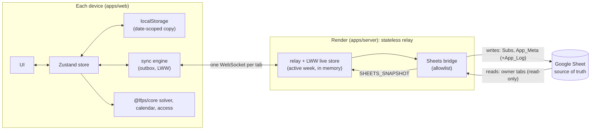
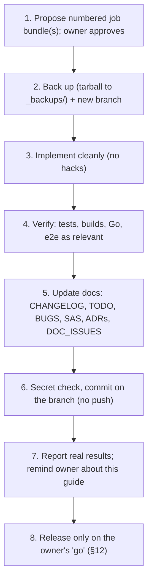

# Little Flower Preparatory School (LFPS) Substitutions Manager & Master Routine Suite
## Master Developer Guide, Architecture Overview & System Blueprint (v2 Next-Gen)

> **Status of this guide:** updated on 2026-10-24 at the owner's request to match the code and docs as of Job Bundle **35a** (branch `bundle/35a`; the live site is still `2.0.0-alpha.2`). It is the narrative overview. The detailed, code-verified reference is [`docs/SAS.md`](docs/SAS.md); decisions are in [`docs/DECISIONS/`](docs/DECISIONS/); every other document is indexed in [`docs/README.md`](docs/README.md). If this guide and the code disagree, the code wins: log it in [`docs/DOC_ISSUES.md`](docs/DOC_ISSUES.md).
>
> 🔒 **This file is owner-controlled.** Change it only when the owner explicitly asks. After any change elsewhere, remind the owner to decide whether this guide should be updated.

---

## 🎨 Painting the Whole Picture on a Blank Canvas: An Introduction for New Developers

Welcome to the **LFPS Substitutions Manager & Master Routine Suite**. Whether you are a newly onboarded software engineer, a systems architect, or an autonomous AI agent, start here. This guide paints the entire picture: from the real-world morning operational crisis in a preparatory school to the constraint solver, the Apple-grade interface physics, and the live relay that keeps every front-desk device in step with the school's Google Sheet.

Read it cover-to-cover, then follow the links into `docs/` for detail. When you finish, you will understand not merely *what* code exists, but *why* it was designed this way, *how* the pieces interact, and *what standards* you are expected to maintain.

---

## Table of Contents

1. [The Real-World Domain Problem & School Operations](#1-the-real-world-domain-problem--school-operations)
2. [What This App Is & Its Core Mission](#2-what-this-app-is--its-core-mission)
3. [Architecture Topology & Monorepo Structure](#3-architecture-topology--monorepo-structure)
4. [Technology Stack & Dependency Breakdown](#4-technology-stack--dependency-breakdown)
5. [Core Abilities & Feature Inventory](#5-core-abilities--feature-inventory)
6. [Design Philosophy, UX Principles & Apple HIG](#6-design-philosophy-ux-principles--apple-hig)
7. [Engineering Directives & Coding Ethics](#7-engineering-directives--coding-ethics)
8. [Domain Data Models & Solver Algorithms](#8-domain-data-models--solver-algorithms)
9. [Client State, Persistence, Versioning & Access](#9-client-state-persistence-versioning--access)
10. [Live Sync, the Relay & the Google Sheets Bridge](#10-live-sync-the-relay--the-google-sheets-bridge)
11. [Developer Onboarding, Environment Setup & Workflow](#11-developer-onboarding-environment-setup--workflow)
12. [Deployment, Releases & Disaster Recovery](#12-deployment-releases--disaster-recovery)
13. [The Documentation Suite](#13-the-documentation-suite)

---

## 1. The Real-World Domain Problem & School Operations

### 1.1 The School Context
**Little Flower Preparatory School (LFPS)** is an early-childhood foundational preparatory institution educating young children across five foundational stages:
* **Pre-Nursery / Nursery** (NUR A, NUR B) — Toddlers aged 3 to 4.
* **Prep / Upper Kindergarten** (PREP A, PREP B) — Children aged 4 to 5.
* **Kindergarten** (KG A, KG B, KG C) — Children aged 5 to 6.
* **Standard 1 & 2** (STD 1, STD 2) — Primary foundational grades.

Young children cannot be left unattended in a classroom for even two minutes. In an early-childhood school, teacher presence is not only an academic requirement; it is a critical child-safety imperative.

### 1.2 The "Morning Rush" Crisis (07:30 – 08:30 AM)
Every school morning between 07:30 and 08:30 AM, the school administration faces an intense logistical puzzle:
1. **Unplanned Sick Leave & Emergencies**: Multiple teachers call in sick, arrive late due to traffic, or face personal emergencies.
2. **Official Deputations (`AWAY_OFFICIAL`)**: Teachers are frequently dispatched on official school business (e.g. CBSE liaison, science supply purchases, sports ground recon, parent meetings, bank tasks, VIP invitations). While legally on duty and present for payroll, they are physically off campus for specific periods.
3. **Class Teacher (CT) Guardianship**: In preparatory grades, each class has a designated **Class Teacher (CT)** who acts as the primary homeroom guardian. If a CT is absent, children experience distress unless an **Officiating Class Teacher (Off. CT)** is assigned for the *whole day* to handle pastoral care, attendance records, lunch supervision, and parent liaison.
4. **Academic Leadership Succession**: The school is led by the **Principal** and, academically, by the **Academic Coordinator (AC)** and the **Assistant Academic Coordinator (AAC)**. If the AC is absent, the AAC automatically assumes operational oversight as Acting AC. If *both* are absent, front-desk staff must immediately designate an acting coordinator.
5. **Co-Teaching Dynamics**: In kindergarten classes, two teachers frequently share the room (e.g. Nursery rhyme sessions, craft, handwriting). Releasing one teacher to cover an urgent vacancy elsewhere must not destabilize the remaining co-teacher.
6. **Curriculum & Workload Constraints**:
   - A teacher can only cover a limited number of substitution periods per day without severe burnout.
   - Specific subjects require appropriate faculty (e.g., Moral Science, Hindi, Mathematics, English, Drawing/Craft).
   - Some teachers may have dedicated administrative duties and should be marked "Free from Sub Duty".

### 1.3 The Failure of the Legacy System
Previously, the school used a combination of physical paper registers, chaotic WhatsApp messages, and a fragile single-file vanilla HTML/JavaScript app (`v1.53.0`, over 10,000 lines in `app.js`, archived unchanged in `legacy-v1/`) that talked to Google Sheets through Apps Script. Updating a single table cell caused entire-page DOM re-renders, race conditions, memory leaks, and frequent mobile browser freezes. Coordinators lost 40+ minutes every morning manually computing substitutions.

The **LFPS Substitutions Manager v2 (Next-Gen)** was conceived and built to eliminate this chaos completely.

---

## 2. What This App Is & Its Core Mission

The **LFPS Substitutions Manager** is a local-first, collaborative web app (React SPA, PWA-style) used at the school's front desk, coupled with a small **stateless Go relay** on Render. **The school's Google Sheet is the source of truth**; the relay is only the live communication medium between devices and the Sheet (ADR-0005).

### Core Mission
1. **Front-Desk Velocity**: Enable the front desk to mark attendance, handle official deputations, resolve the day's substitution vacancies and export the register in under **90 seconds**, with **no login wall**.
2. **Deterministic, Conflict-Free Intelligence**: Provide a scoring solver that balances teacher workloads, honours subject specialisations, protects co-teachers and eliminates double-bookings.
3. **Apple-Grade Tactile Experience**: Fluid spring physics, zero visual clutter, GPU-only animation.
4. **Resilience**: Full offline usability from each device's local copy, with edits queued and synced through the relay when it is reachable, and a clear **Connecting… / Live / Offline** status.

---

## 3. Architecture Topology & Monorepo Structure

The repository is an **npm workspaces** monorepo (ADR-0001). Full reference: [SAS §3](docs/SAS.md#3-repository-topology-npm-workspaces).

```
LFPS_Substitutions_Manager/
├── packages/
│   ├── core/          @lfps/core: pure TypeScript domain engine (no DOM)
│   │   ├── src/types/ · solver/ · disambiguation/ · calendar/ (IST) · access/ (admin offices) · data/seed.ts
│   │   └── test/      solver, calendar, access (Vitest)
│   └── ui/            @lfps/ui: design tokens (springs, colour roles, glass presets)
├── apps/
│   ├── web/           @lfps/web: React 19 + Vite 6 + Tailwind v4 + Zustand
│   │   ├── src/components/   UI (RoutineGrid, SubstitutionsRegister, AbsenceRoster, modals, …)
│   │   ├── src/store/        useTimetableStore.ts (state, undo) · persistence.ts (date-scoped localStorage)
│   │   ├── src/sync/         live.ts · engine.ts · client.ts · entities.ts · status.ts · sheetData.ts · reference.ts · relayGuard.ts
│   │   ├── src/lib/          access.ts (resolveAccess) · adminGate.ts (passcode) · buildInfo.ts (version/commit/branch)
│   │   ├── test/             Vitest (jsdom)
│   │   ├── e2e/              sheets-restart.mjs (Playwright, local relay + fake Sheet)
│   │   └── .env.production   public production relay URLs (the only place they live)
│   └── server/        Go module lfps/server (go 1.23): the stateless relay
│       ├── cmd/api/          entrypoint (port 8080)
│       ├── cmd/sheetcheck/   Sheets setup checker / self-test
│       ├── internal/         relay · livesync (LWW store) · ws (hub) · sheets (bridge, allowlist) · handlers (REST, CORS) · schooltz · excel · storage (types only) · version
│       └── Dockerfile        golang:1.23-alpine builder → alpine:3.20 runtime
├── scripts/           version.mjs · hash-admin-passcode.mjs · build-web-local.mjs
├── .github/workflows/ci.yml   CI (gates Render deploys)
├── render.yaml        Render service definition (Blueprint)
├── legacy-v1/         archived v1.53.0 for parity auditing
├── docs/              the documentation suite (§13)
├── index.html, assets/        committed Pages build (written only by the release build)
└── package.json       workspace root; the single source of the version
```

### High-Level Architectural Flow



---

## 4. Technology Stack & Dependency Breakdown

Every dependency was chosen deliberately (**Prime Directive: best strategies first**). Exact versions are in the `package.json` files and `apps/server/go.mod`; the ranges below are indicative.

### 4.1 Client Layer (`apps/web`)

| Technology | Version | Purpose & Rationale |
| :--- | :--- | :--- |
| **React** | 19 | Declarative, component-driven UI. |
| **TypeScript** | 5.7 | Strict type safety. |
| **Vite** | 6 | ESM dev server and production bundling (`base: './'` for Pages). Defines the build-info constants. |
| **Tailwind CSS** | 4 | Utility-first CSS with zero runtime overhead. |
| **Framer Motion** | 12 | GPU spring physics, FLIP layout projections, drag gestures. |
| **Zustand** | 5 | Minimal client state; per-tab undo stacks (ADR-0002). |
| **Lucide React** | 0.475 | Consistent SVG icons. |
| **Vitest** | ^3.0.5 (3.2.x installed) | Unit tests (jsdom). `npm audit` reports 3 advisories through Vitest 3; the fix needs Vitest 4. |

### 4.2 Domain Core Package (`packages/core`)

| Technology | Purpose & Rationale |
| :--- | :--- |
| **Pure TypeScript** | Headless domain core with no DOM, browser or Node runtime dependencies. Compiles to ESM + `.d.ts` in `dist/`. |
| **Vitest** | Solver, calendar (IST) and access tests. |

### 4.3 Relay (`apps/server`)

| Technology | Version | Purpose & Rationale |
| :--- | :--- | :--- |
| **Go** | 1.23 (`go.mod`: `go 1.23.2`; newer toolchains work) | Small, fast, concurrent relay. Replaced slow per-device Google Apps Script calls. |
| **Gorilla WebSocket** | 1.5 | The live sync channel. |
| **Google Sheets API (v4)** | via `google.golang.org/api` | Only in `internal/sheets/google.go`, authenticated by a service account. |
| **Excelize v2** | 2.8 | Streams the daily register as `.xlsx` (`/api/v1/export/excel`); nothing is written to disk. |

---

## 5. Core Abilities & Feature Inventory

The suite provides a rich inventory of specialized features tailored for school operations:

```
┌────────────────────────────────────────────────────────────────────────┐
│                        CORE APPLICATION ABILITIES                      │
├────────────────────────────────┬───────────────────────────────────────┤
│ 1. ROUTINE GRID MATRIX         │ 2. INTELLIGENT SUBSTITUTION ENGINE    │
│ • Dual View (Faculty / Class)  │ • 1-Tap Smart Auto-Resolve Solver     │
│ • Fullscreen Workstation Mode  │ • Subject Expertise & Affinity Engine │
│ • Drag-and-Drop Cell Swapping  │ • Multi-Period Workload Balancing     │
│ • Limbo Tray & Displace Flash  │ • Free from Sub Duty Exemption Toggle │
│ • Away Duty Marquee Selection  │ • Co-Teacher Protection Protocols     │
├────────────────────────────────┼───────────────────────────────────────┤
│ 3. STAFF ATTENDANCE & ROSTER   │ 4. OFFICIATING & SUCCESSION           │
│ • High-Density Squircle Cards  │ • Whole-Day Officiating CT Precedence │
│ • 0ms Direct Attendance Toggle │ • Academic Coordinator Succession     │
│ • Role Hierarchy & A-Z Sorting │ • Clubbed Multi-Appointment Banners   │
│ • Zero Pass-Thru Direct Tap    │ • Purple Leadership Attention Halos   │
├────────────────────────────────┼───────────────────────────────────────┤
│ 5. COLLABORATION & AUDITING    │ 6. PRODUCTIVITY & POWER TOOLS         │
│ • Live Sync Across Devices     │ • Isolated 3-Tab Undo/Redo Engine     │
│ • 20ms Excel Daily Report Gen  │ • 5-Tap Developer Diagnostics Mode    │
│ • Staff Login + Admin Passcode │ • Dynamic Island Floating Day Bar     │
│ • Accept & Dispute Duty Rails  │ • 12-Theme Glass & Retro Engine       │
└────────────────────────────────┴───────────────────────────────────────┘
```

### Detailed Breakdown of Key Capabilities:

#### 1. Dynamic Island Day Bar
* Positioned as a floating pill at the top of the viewport.
* Automatically morphs on scroll between a full-width day selector and a compact capsule displaying the active day with symmetrical spring physics (`ISLAND_SPRING`).
* Incorporates directional hysteresis (`deltaThreshold = 25px`) to prevent visual flutter on mobile touchscreens.

#### 2. Dual-View Routine Matrix & Fullscreen Workstation
* **Faculty View**: Rows represent teachers, columns represent periods.
* **Class View**: Rows represent classes (`PREP A`, `KG B`, etc.), columns represent periods.
* **Sticky Navigation**: Corner cells and headers remain rigidly pinned during 2-axis scrolling using opaque masks (`bg-slate-950`) to prevent bleed-through.
* **Fullscreen Workstation Overlay (`isFitGrid`)**: Transforms the matrix into an edge-to-edge spreadsheet workstation with body-scroll locking and <kbd>Esc</kbd> dismissal.
* **Drag-and-Drop Cell Reordering**: Teachers' periods can be moved or swapped. If an occupied cell is targeted, the displaced slot triggers a red alert pulse (`cell-displaced-flash`) and drops into the **Limbo Tray** for restoration or reassignment.

#### 3. Away on Official Duty Mode (Grid Marquee + Modal)
* Accommodates teachers who leave campus on school business.
* **Modal Dialog**: Choose period chips (`All Day`, `Morning`, `Afternoon`, `Clear`), input official venue (e.g. *CBSE Workshop*), and save.
* **Grid Marquee Mode**: Tapping "Select on Grid Marquee" dims all non-target rows to 25% opacity with `pointer-events-none`. Dragging across the teacher's row sweeps an animated dashed marquee (`away-period-marquee`). Saving persists the periods and updates the substitution register.

#### 4. Whole-Day Officiating Class Teacher Precedence
* When a primary Class Teacher is absent, the officiating CT is designated for the **entire day** to maintain pastoral stability for young children.
* Sub-period instructional tasks continue to be assigned intelligently across available staff based on subject specialization.

#### 5. Academic Coordinator Succession (LOGIC-04)
* When the AC is present, the AC retains oversight.
* If the AC is absent and the AAC is present, the AAC automatically acts as AC.
* If *both* are absent, the front desk appoints an **Officiating AC (Off. AC)** for the day; until then the system flags it.
* Implemented by `getEffectiveOfficiatingAC` in `@lfps/core` (see [SAS §4.2](docs/SAS.md#42-academic-coordinator-succession-logic-04)).

#### 6. Multi-Tab Isolated Undo/Redo Engine
* Independent 30-snapshot history stacks for **Routine Matrix**, **Substitutions**, and **Staff Roster**.
* Undoing a substitution assignment never alters staff attendance records or routine timetable cells.
* Supports keyboard shortcuts: `⌘Z` / `Ctrl+Z` (Undo), `⌘⇧Z` / `Ctrl+Y` (Redo).
* Undo history is device-local: it never syncs, and remote changes from other devices do not rewrite it (see ADR-0002).

---

## 6. Design Philosophy, UX Principles & Apple HIG

The visual and interactive foundation of this application is governed strictly by [DESIGN_PHILOSOPHY.md](DESIGN_PHILOSOPHY.md). Every engineer working on this codebase must adhere to these tenets:

### 6.1 The Materiality Principle
Digital interfaces must feel like precision physical instruments. UI elements have mass, inertia, spring tension, and tactile resistance. Snap transitions and robotic linear timers are prohibited.

### 6.2 Damped Harmonic Oscillator Spring Physics
All UI transitions use genuine physical springs. The shared ones live in `@lfps/ui`:
```ts
// packages/ui/src/tokens.ts
export const SPRING_TRANSITIONS = {
  snappy: { type: 'spring', stiffness: 450, damping: 32, mass: 0.8 },
  bouncy: { type: 'spring', stiffness: 320, damping: 24, mass: 1 },
  smooth: { type: 'spring', stiffness: 260, damping: 28, mass: 1.2 },
  // plus cssCubic
};
```
The Day Bar's `ISLAND_SPRING` (`duration: 0.55`, `bounce: 0.12`) is a local constant in `apps/web/src/components/Header.tsx`, not a `@lfps/ui` token.
* **Timing Symmetry**: An expand animation and a collapse animation must have equal weight. Never rush a closing animation.

### 6.3 Uncapped 120fps Hardware Compositing
* **Never Animate Layout Reflow Triggers**: Animating `width`, `height`, `top`, `left`, `margin`, or `padding` forces the CPU to recalculate page geometry on every frame, causing stutter.
* **Strict GPU Properties**: Only animate `transform: translate3d(...) scale(...)` and `opacity`.
* **CSS Transition Guard**: Never apply CSS `transition: all` or `transition-transform` to elements managed by Framer Motion. Doing so causes the browser's CSS engine and Framer Motion's JS engine to conflict.

### 6.4 Speed-of-Light "Front Desk Velocity"
* **Zero Travel Distance**: Anchor context popovers directly adjacent to the cursor or touch target. Never force coordinators to reach across widescreen monitors.
* **Non-Blocking Operation**: The front desk must have instant access to inspect, filter, mark attendance, assign substitutes, appoint Off. AC / Off. CT and export, **without any login wall**. The admin passcode gates only admin actions (§9.3).
* **Progressive Disclosure**: Keep the primary canvas clean. Surface only the vital 20% of information needed for 80% of daily tasks; place diagnostic sandboxes behind deliberate gestures (e.g. 5-tap version easter egg).

### 6.5 Functional Color Semantics
Color carries unambiguous operational meaning:
* **Academic Coordinator (AC)**: Royal Violet (`#8b5cf6`) — Master leadership.
* **Assistant Academic Coordinator (AAC)**: Royal Violet (`#8b5cf6`) — Aligned leadership.
* **Class Teachers (CT)**: Golden Amber (`#f59e0b`, FEAT-56) — Homeroom guardianship. Note: "Free from Sub" uses the same amber.
* **Subject Teachers (ST)**: iOS Blue (`#007aff`) — Instructional faculty.
* **Available for Sub / Present**: Emerald Green (`#10b981`) — On duty and available.
* **Absent**: Crimson Red (`#ff3b30`) — Uncovered absence requiring substitution.
* **Away (Official)**: Slate Indigo (`#475569`) — School-sanctioned deputation.

The authoritative token values are in `packages/ui/src/tokens.ts` and [SAS §5](docs/SAS.md#5-design-tokens--lfpsui).

---

## 7. Engineering Directives & Coding Ethics

### 7.1 Prime Directive: Best Strategies First
* Never commit quick hacks, monkey patches, or brittle workarounds. If an architectural problem exists, resolve it at the root.
* Prefer simple, reversible changes. Protect the front desk against accidents.

### 7.2 Strict Type Safety
* Every domain entity, action payload and wire message has an explicit TypeScript type or Go struct. Do not add new `any`; a few legacy occurrences remain and are tracked (DOC_ISSUES DI-19).
* Domain logic belongs in `@lfps/core` as pure, unit-tested functions; visual constants in `@lfps/ui`; React components orchestrate, they don't compute.
* The Go `DailyState`/`SubstitutionAssignment` structs are hand-kept copies of the TS types. Keep them in step ([SAS §7.2](docs/SAS.md#72-cross-language-model-drift)).

### 7.3 Documentation Integrity
* Every change updates the suite (§13): CHANGELOG `[Unreleased]`, TODO, BUGS, SAS, ADRs and DOC_ISSUES as relevant. Every issue gets an ID (`BUG-`, `FEAT-`, `SEC-`, `ARCH-`, `UI-`, `PERF-`, `EPIC-`, `DI-`).
* Never break tests. Verify with the commands in §11.3 and report real numbers.

### 7.4 Branch Safety, Backups & Releases (owner rule)
* **Before any refinement**, archive a tarball into `_backups/` (git-ignored) and create a **new branch** for the work (one per job bundle, e.g. `bundle/35a`, cut from the latest bundle branch or `next-gen`). **Never touch `main`.**
* **Nothing is pushed or released without the owner's explicit "go".** A push to `next-gen` is a production release of both the website (Pages) and the relay (Render).
* Create a **rollback tag** before every release. No force-push, history rewrite or rollback without the owner's explicit approval.
* Details: [`docs/WORKFLOW.md`](docs/WORKFLOW.md) §2–§3 and §5.

### 7.5 Secrets
* The admin passcode, its hash and the Google service-account key are **never** printed, logged or committed. The hash lives only in the git-ignored `apps/web/.env.local` (or a CI variable); the key lives only in a Render Secret File and, for local checks, a chmod-600 file **outside** the repo that is deleted after use.
* Run a staged-diff secret check before every commit. If a secret ever reaches git history, purge it before any push (with the owner's approval).
* The one by-design exception: the release build embeds the passcode **hash** in the public JS bundle (client-side gate, SEC-01). See §9.3.

### 7.6 Respect the Owner's Sheet
* The app writes **only** its own tabs (`Subs`, `App_Meta`, optional `App_Log`). Owner tabs (including the hidden `_DB_Helper`) are read-only: never write to, unhide, rename, reorder or reprotect them. The legacy v1 tabs `Daily_Ledger` and `Baseline_Updates` stay untouched until the owner decides ([SHEETS_SETUP §5](docs/SHEETS_SETUP.md#5-owner-decisions-proposals-nothing-applied)).

---

## 8. Domain Data Models & Solver Algorithms

The domain logic is isolated entirely in `packages/core` (modules: `types`, `solver`, `disambiguation`, `calendar`, `access`, `data/seed`; see [SAS §4](docs/SAS.md#4-domain-core--lfpscore)).

### 8.1 Cell Grammar & Parsing (`parseCellSlot`)
Routine timetable cells are stored as compact strings:
* `"KG A Eng"` $\to$ `{ className: "KG A", subject: "Eng", isCoTeaching: false }`
* `"PREP B Math + NUR A"` $\to$ `{ className: "PREP B", subject: "Math", isCoTeaching: true, coTeachingPartnerClass: "NUR A" }`
* `"Free"`, `"-"`, `""` $\to$ Empty / non-instructional slots.
* `"M. SC."` or `"M.SC"` $\to$ Strictly normalized to `"Moral Science"` (never "Mental Science").

### 8.2 Candidate Substitute Discovery (`findAvailableSubstitutes`)
To find suitable substitutes for an uncovered slot `(day, period, targetTask, originalTeacher)`:
1. **Filter Busy Teachers**: Disqualify teachers already assigned an instructional class during this period in `schedule[day][period]`.
2. **Filter Absent Teachers**: Disqualify teachers marked absent for the day, or teachers whose `AWAY_OFFICIAL` deputation covers this period.
3. **Filter Exempt Teachers**: Disqualify teachers marked "Free from Sub Duty" (`availabilities[teacher].isFreeFromSub === true`).
4. **Co-Teaching Safety Check**: Disqualify teachers acting as sole solo teachers in kindergarten rooms during that period.
5. **Affinity Scoring** (`calculateCandidateAffinity`): base 100, plus same subject (`sameSubjectWeight`, default 40), Class Teacher of the section (35), 2nd teacher in the department (30), same department (+15), Principal preferred-subject override (+80), designated Off. CT familiarity (+30 when `prioritizeOfficiatingCT` is on); minus workload (`existingSubs × workloadBalancingWeight`, floored at −40) and sandwiched-period fatigue (15). Clamped at 0. Weights are the owner-tunable `AutoResolvePolicyConfig` (`DEFAULT_AUTORESOLVE_POLICY`). The exact table is in [SAS §4.1](docs/SAS.md#41-candidate-scoring-calculatecandidateaffinity); the code is authoritative.

### 8.3 Smart Auto-Resolve Solver (`autoResolveSubstitutions`)
The auto-resolve engine solves the global bipartite matching problem for all uncovered periods in the day:
1. Gathers all uncovered slots across the school day.
2. Sorts slots by priority:
   * Class Teacher homeroom slots first.
   * Core academic subjects (English, Mathematics, Hindi) second.
   * Activity and games periods third.
3. Iteratively allocates candidates with the highest affinity score while enforcing a strict maximum daily cap per teacher.
4. Returns an immutable `AutoResolvePlan` containing the proposed substitution list and an explanation log.

### 8.4 School Calendar & IST (`calendar`)
The school runs on **India Standard Time**. Render cannot set a time zone, so both sides compute school time **in code**: `SCHOOL_TIME_ZONE = 'Asia/Kolkata'` in `@lfps/core` (`schoolDateFor`, `activeWeekStart`, `schoolWeekDates`, …) and `internal/schooltz` on the server (default `Asia/Kolkata`, overridable by `APP_TZ`/`TZ`, zone data embedded). "Today", date keys, the **Sunday 00:00 week switch**, midnight rollover, pruning and the Excel file name all follow the school's zone, whatever the device's zone is. Tests run under several device zones. See [SAS §6.4](docs/SAS.md#64-school-time-zone).

---

## 9. Client State, Persistence, Versioning & Access

### 9.1 Store
The client uses one **Zustand** store (`apps/web/src/store/useTimetableStore.ts`). It holds the schedule and its base, absences, availability, substitutions, displaced ("limbo") cells, Off. AC / Off. CT, notifications, login and admin identity, the dev editing override, the solver policy, the 12 themes and view/sort preferences. Each tab (`routine`, `substitutions`, `roster`) has its own undo/redo history of 30 snapshots (ADR-0002). Modals are mounted at the root of the tree (ADR-0003). Full reference: [SAS §6.1–6.2](docs/SAS.md#62-state--storeusetimetablestorets-zustand).

### 9.2 Date-Scoped Local Persistence (`store/persistence.ts`)
* Each device keeps its own copy in `localStorage` so a reload or restart loses nothing. The operational document `lfps_operational_state` is keyed by **date** (`days[YYYY-MM-DD]`) and by week; preferences, solver policy and the last applied Sheet data (`lfps_reference_v1`) have their own keys.
* MON–SAT map to the dates of the **active school week** (Sunday → the coming week). Writes are debounced (250 ms) and flushed on `pagehide`; days older than 42 days are pruned; a corrupt or newer-schema document is backed up before it is replaced.
* **In-app timetable edits are date-scoped substitutions**: they change that date only and never the master timetable. The master routine comes read-only from the Sheet; editing it is a future epic (EPIC-01).

### 9.3 Roles, Admin Gate & "Edit without login"
* **Front Desk** (`GUEST`, nobody logged in) is the default and **never hits a login wall**: it can view everything and record attendance, substitutions and Off. AC / Off. CT.
* **Admins** are the office holders for the day: the **Principal**, the **AC**, the **AAC** and the day's **Officiating AC** (`adminOfficeFor()` in `@lfps/core`). Picking one of them in **Staff Login** asks for the **6-digit admin passcode** (escalating per-device lockout). Admin adds: routine (master timetable) edits, solver policy, Reset Day, history purge, developer mode.
* One pure function, **`resolveAccess()`** (`lib/access.ts`), decides `{role, isAdmin, office, canEdit, editingUnlocked}`; the UI (`PermissionGuard`, `usePermissions`) and the store guards both use it.
* **Developer Options** (Settings → tap the build info 5 times; needs an admin login until SEC-03) has a device-local switch, **"Edit without login"**, that unlocks editing with nobody signed in; the header then shows an amber **"Editing unlocked"** badge. It never syncs.
* The passcode's SHA-256 is baked into the build from `VITE_ADMIN_PASSCODE_SHA256` (git-ignored `apps/web/.env.local`). This is **client-side only** and protects against accidents, not attackers; server-side auth is SEC-02. Setup and hashing: [`docs/ADMIN_ACCESS.md`](docs/ADMIN_ACCESS.md).

### 9.4 Version (single source) & Build Info
* The version lives **only** in the root `package.json` (SemVer pre-releases, `2.0.0-alpha.N`, [`docs/VERSIONING.md`](docs/VERSIONING.md)). `npm run version:sync` copies it to the workspaces and the Go server (`internal/version`); `npm run version:check` (part of `npm test`) fails on drift. Bump once per shipped bundle.
* The app shows it in the **header**, the **footer** (`v<version> · <commit> · <branch>`) and **Settings → Build Info**; the relay returns it from `/api/v1/health`.

---

## 10. Live Sync, the Relay & the Google Sheets Bridge

Full protocol and limits: [SAS §2.1, §6.3, §7](docs/SAS.md#63-live-sync--srcsync-bundles-35-35a); decision: [ADR-0005](docs/DECISIONS/0005-sheets-source-of-truth-stateless-relay.md); Sheet rules: [`docs/SHEETS_SETUP.md`](docs/SHEETS_SETUP.md).

### 10.1 Why a Relay
Devices never talk to Google directly: per-device Sheets calls are too slow for the front desk, and the school's old computers are not on 24×7, so none can host a hub. The **Render relay** keeps only the **active school week in memory** (no disk, no database) and fans changes out to every device. **Google Sheets is the source of truth.**

### 10.2 Device ⇄ Relay
* **One WebSocket per browser tab** (`sync/live.ts`, ref-counted singleton) at `${VITE_WS_URL}/api/v1/ws`.
* The store's synced fields for the active week are split into small keyed **entities** (`abs|…`, `sub|…`, `avail|…`, `oac|…`, `oct|…`, `sched|…`, `limbo|…`). Each travels as `{k, v, ts, by}`; `v: null` is a deletion (tombstone).
* Messages: `HELLO` → `HYDRATE` (the relay's whole week); `STATE_MUTATION` (batched) → `MUTATION_ACK` and broadcast to the others; `PRESENCE`; `SHEETS_SNAPSHOT`; `ERROR`.
* **Conflicts: last writer wins per entity**, by `(ts, deviceId)`; the relay clamps clocks running ahead.
* Local edits go to a persisted **outbox** and are resent until acknowledged, so the app works offline and catches up on reconnect. Status pill: **Connecting…** (amber, also while a sleeping Render relay wakes, ~1 min) → **Live** → **Offline**.

### 10.3 Relay ⇄ Google Sheets
* **Writes go only to app-owned tabs**, enforced by an allowlist (`internal/sheets` `guard`): **`Subs`** (schema 2: one row per substitution, upserted by key, never deleted; a deletion is a `REMOVED` tombstone row with Deleted At, plus Version TS/By and the Payload) and **`App_Meta`** (schema version, app version, last pull, `data_version`, …), plus **`App_Log`** only with `SHEETS_LOG=1`. Writes are async, batched, debounced and retried, so a slow Sheet never blocks a device.
* **Reads**: the visible owner tabs in **one** `batchGet` at start and every `SHEETS_PULL_INTERVAL` (default 5 min); hidden tabs are skipped. Devices apply Staff Directory, the per-teacher routine tabs and Subjects List with precedence **local date-scoped edits > Sheet > bundled seed**.
* **Rehydrate on restart**: in sheets mode the relay starts **hydrating**, reads the week's substitutions and tombstones back from `Subs`, then lets devices in (`/health` → `store: ready`); after `SHEETS_HYDRATE_TIMEOUT` (20 s) it opens degraded and keeps retrying. Other entities are refilled by the devices.
* Without Sheets configuration the relay runs **relay-only** (live sync, nothing written).

### 10.4 Server Configuration (env vars)

| Variable | Purpose |
| :--- | :--- |
| `PORT` | default 8080 |
| `ALLOWED_ORIGINS` | comma-separated CORS / WebSocket origin allowlist (default allows the Pages origin and localhost; `*` = any) |
| `APP_TZ` / `TZ` | optional override of the school zone (default `Asia/Kolkata` in code; no Render setting needed) |
| `SHEETS_SPREADSHEET_ID` | the Sheet's ID (config only, never in Go code; set in `render.yaml`) |
| `GOOGLE_APPLICATION_CREDENTIALS` | path to the service-account key (Render Secret File `/etc/secrets/sa.json`) |
| `SHEETS_PULL_INTERVAL` / `SHEETS_LOG` / `SHEETS_HYDRATE_TIMEOUT` | optional: 5m / 0 / 20s |
| `SHEETS_FAKE_FILE` | local tests only (a JSON fake Sheet); never in production |

`DATA_DIR` is ignored (the relay stores nothing). REST: `GET|HEAD /api/v1/health` (version, school-zone timestamp, `mode`, `store`, `sheets`; kept cheap for health checks and the uptime pinger), `/meta`, `/state`, `/export/excel`, `/ws`. There is no server auth yet (SEC-02).

### 10.5 Client Configuration & the Production-Relay Guard
* `apps/web/.env.production` (committed) holds the **public** production relay URLs (`VITE_API_URL`, `VITE_WS_URL`) and is loaded **only** by a production build. Dev, tests and local builds default to `localhost:8080`.
* `apps/web/.env.local` (git-ignored) holds `VITE_ADMIN_PASSCODE_SHA256`. Nothing secret is ever committed.
* **Relay guard** (`sync/relayGuard.ts`, checked in `vite.config.ts` and `sync/live.ts`): a non-production build refuses a production relay URL unless `VITE_ALLOW_PROD_RELAY=1`. `npm run build:web:local` builds for a loopback relay and asserts the bundle contains no production host. Every local browser test must use a **local** relay.

---

## 11. Developer Onboarding, Environment Setup & Workflow

### 11.1 Prerequisites
* **Node.js** 20 (CI uses 20) with npm 10+
* **Go** 1.23+ (only for `apps/server`)
* **Git**; Playwright only for the browser e2e test (not a repo dependency)

### 11.2 Initial Setup
```bash
git clone https://github.com/steph1420/LFPS_Substitutions_Manager.git
cd LFPS_Substitutions_Manager
git switch -c <bundle-or-feature-branch> next-gen   # never work on main; see §7.4
npm ci
npm run build:libs                                  # @lfps/ui then @lfps/core (needed before dev:web)
# optional, for admin features: create apps/web/.env.local per docs/ADMIN_ACCESS.md
```

### 11.3 Commands

| Purpose | Command |
| :--- | :--- |
| Dev server (port 5173) | `npm run dev:web` |
| Ordered library build | `npm run build:libs` (`build:ui` → `build:core`; web and core import `@lfps/ui` from `dist`) |
| Web build (work branches) | `npm run build:web` (output only in `apps/web/dist`) |
| Release build (**release only**) | `npm run build` = `build:pages`: builds and copies `dist` into the repo root `index.html` / `assets/` that Pages serves. Never run it on a work branch |
| Local-relay build for browser tests | `npm run build:web:local` |
| All JS tests + version check | `npm test` (core 35, web 73 at 35a; one web test runs only where the owner's passcode is configured) |
| Version | `npm run version:check` / `npm run version:sync` |
| Admin hash | `npm run admin:hash` (see ADMIN_ACCESS) |
| Go checks | `cd apps/server && gofmt -l . && go vet ./... && go test -race ./...` (46 top-level tests) |
| Browser e2e (no Google needed) | `PLAYWRIGHT_FROM=<dir with playwright> npm run e2e:sheets`: two browsers, a local relay in sheets mode with a fake Sheet, a restart mid-test (22 checks) |
| Real-Sheet check | `cd apps/server && go run ./cmd/sheetcheck` (read-only report); `-selftest` writes and removes test rows in `Subs` only and proves no other tab changed; `-ensure` creates the app tabs; `-protect` (owner's choice) protects the app tabs. Needs the key file and spreadsheet ID; see [SHEETS_SETUP §3](docs/SHEETS_SETUP.md#3-verify-with-sheetcheck) |

The full verification matrix is [`docs/WORKFLOW.md` §4](docs/WORKFLOW.md#4-verification-matrix).

### 11.4 The Job Bundle Cycle

Size bundles to what can really be finished and verified; split them (e.g. 35 → 35a) rather than overreach. Details: [`docs/WORKFLOW.md`](docs/WORKFLOW.md), [`CONTRIBUTING.md`](CONTRIBUTING.md).

---

## 12. Deployment, Releases & Disaster Recovery

### 12.1 Website (GitHub Pages)
* Pages serves the **root of branch `next-gen`** ("Deploy from a branch", ADR-0004): the committed `index.html` and `assets/` produced by the release build. Live: `https://steph1420.github.io/LFPS_Substitutions_Manager/`.
* Moving to a CI-built Pages artifact and per-branch previews is planned (Bundle 36).

### 12.2 Relay (Render)
* `apps/server/Dockerfile` (multi-stage, `golang:1.23-alpine` → `alpine:3.20`, zone data embedded). Live: `https://lfps-substitutions-manager.onrender.com`, health `/api/v1/health`.
* **`render.yaml`** describes the service: Docker, branch `next-gen`, health check, **`autoDeployTrigger: checksPass`** and the env var names. The key is a Render **Secret File**, never in the repo. See [`docs/RENDER_SETUP.md`](docs/RENDER_SETUP.md).
* **CI** (`.github/workflows/ci.yml`, on pushes and PRs to `next-gen`): Go `gofmt`/`vet`/`test -race` and a check that the spreadsheet ID is not compiled in; web `npm ci`, `build:web`, `npm test`. With "After CI Checks Pass", Render deploys only when CI is green.
* The free tier sleeps after 15 minutes idle; the owner's cron-job.org pinger keeps it warm in school hours using a **HEAD** request to `/api/v1/health` (BUG-31).

### 12.3 Releases
Releases happen **only on the owner's explicit go**, following [`docs/WORKFLOW.md` §5](docs/WORKFLOW.md#5-releasing-to-production-owner-approved-only) and the release runbook (currently [`docs/RELEASE_2.0.0-alpha.3.md`](docs/RELEASE_2.0.0-alpha.3.md)): back up → merge the bundle into `next-gen` → `version:sync` + CHANGELOG section → release build with the admin hash, prune stale `assets/` → tags `rollback/pre-v<next>` and `v<next>` → owner's Render steps → push → verify health and a two-device check. Client and relay must go live together when the protocol changes.

### 12.4 Disaster Recovery & Rollback
* **Relay:** Render → the service → Events/Deploys → previous deploy → **Rollback**.
* **Website:** revert the release commits on `next-gen` (no history rewrite), rebuild, push. Resetting to a `rollback/pre-…` tag needs a force-push and the owner's explicit approval.
* **Local snapshots:** tarballs in `_backups/` (they contain secrets such as `.env.local`; never share or commit them). Restore into a scratch folder and compare before replacing anything.
* Devices keep their local data through any rollback. Details: the release runbook §5 and [`docs/RENDER_SETUP.md` §5](docs/RENDER_SETUP.md#5-rollback).

---

## 13. The Documentation Suite

Start at [`docs/README.md`](docs/README.md). The key documents:

| Document | What it is |
| :--- | :--- |
| [`docs/SAS.md`](docs/SAS.md) | Architecture specification, verified against the code |
| [`docs/DECISIONS/`](docs/DECISIONS/) | ADR-0001 monorepo · 0002 per-tab undo · 0003 root modals · 0004 Pages from `next-gen` · 0005 Sheets source of truth, stateless relay |
| [`CHANGELOG.md`](CHANGELOG.md) / [`docs/VERSIONING.md`](docs/VERSIONING.md) | Keep a Changelog (`[Unreleased]` first) and SemVer rules |
| [`TODO.md`](TODO.md) / [`BUGS.md`](BUGS.md) | Bundle plan and work items / bug tracker (IDs) |
| [`docs/WORKFLOW.md`](docs/WORKFLOW.md) / [`CONTRIBUTING.md`](CONTRIBUTING.md) | Job-bundle cycle, backups, branches, verification, releases |
| [`docs/ADMIN_ACCESS.md`](docs/ADMIN_ACCESS.md) | Admin hierarchy, passcode setup, lockout |
| [`docs/SHEETS_SETUP.md`](docs/SHEETS_SETUP.md) / [`docs/RENDER_SETUP.md`](docs/RENDER_SETUP.md) | Google Sheets and Render setup, checks and owner decisions |
| [`docs/RELEASE_2.0.0-alpha.3.md`](docs/RELEASE_2.0.0-alpha.3.md) | Prepared go-live runbook |
| [`docs/DOC_ISSUES.md`](docs/DOC_ISSUES.md) | Contradictions between documents and code |
| [`DESIGN_PHILOSOPHY.md`](DESIGN_PHILOSOPHY.md) | UX and motion rules |

`ARCHITECTURE.md`, `CATCH_UP_TO_ME.md` and `CLOUD_CONNECTIONS_AND_ROLLBACK_GUIDE.md` predate Bundle 34 and are partly stale (ARCH-03, Bundle 38); prefer SAS and the setup guides.

---

*Authored for the Little Flower Preparatory School Engineering Team. Maintain this standard without compromise.*
