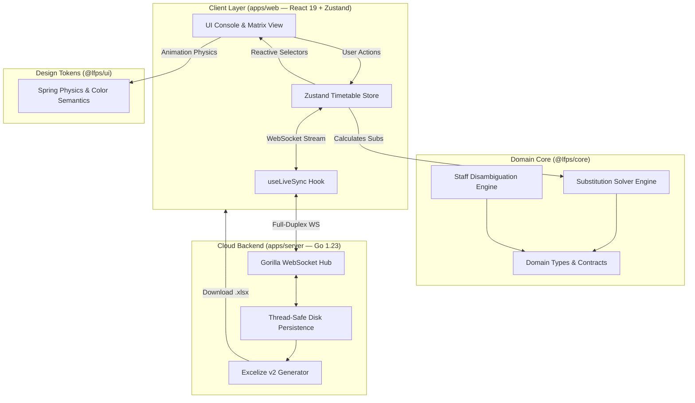
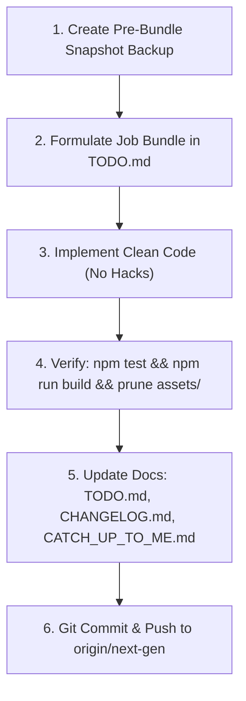

# Little Flower Preparatory School (LFPS) Substitutions Manager & Master Routine Suite
## Master Developer Guide, Architecture Specification & System Blueprint (v2.0 Next-Gen)

---

## 🎨 Painting the Whole Picture on a Blank Canvas: An Introduction for New Developers

Welcome to the **LFPS Substitutions Manager & Master Routine Suite**. Whether you are a newly onboarded software engineer, a systems architect, or an autonomous AI agent, this document is your definitive single source of truth. It was authored to paint the entire picture of this project on a blank canvas—from the real-world morning operational crisis in a preparatory school to the mathematical constraint solvers, Apple-grade interface physics, and high-concurrency cloud synchronization microservices that solve it.

Read this document cover-to-cover. When you finish, you will understand not merely *what* code exists in this repository, but *why* it was designed this way, *how* every system interacts, and *what standards* you are expected to maintain.

---

## Table of Contents

1. [The Real-World Domain Problem & School Operations](#1-the-real-world-domain-problem--school-operations)
2. [What This App Is & Its Core Mission](#2-what-this-app-is--its-core-mission)
3. [Architecture Topology & Monorepo Structure](#3-architecture-topology--monorepo-structure)
4. [Technology Stack & Dependency Breakdown](#4-technology-stack--dependency-breakdown)
5. [Core Abilities & Feature Inventory](#5-core-abilities--feature-inventory)
6. [Design Philosophy, UX Principles & Apple HIG](#6-design-philosophy-ux-principles--apple-hig)
7. [Engineering Directives & Coding Ethics](#7-engineering-directives--coding-ethics)
8. [Domain Data Models & Solver Algorithms](#8-domain-data-models--solver-algorithms)
9. [State Management, Optimistic Mutations & Undo/Redo Engine](#9-state-management-optimistic-mutations--undoredo-engine)
10. [Real-Time WebSocket Protocol & Cloud Microservice](#10-real-time-websocket-protocol--cloud-microservice)
11. [Developer Onboarding, Environment Setup & Workflow](#11-developer-onboarding-environment-setup--workflow)
12. [Deployment Pipeline & Disaster Recovery](#12-deployment-pipeline--disaster-recovery)

---

## 1. The Real-World Domain Problem & School Operations

### 1.1 The School Context
**Little Flower Preparatory School (LFPS)** is an early-childhood foundational preparatory institution educating young children across five foundational stages:
* **Pre-Nursery / Nursery** (NUR A, NUR B) — Toddlers aged 3 to 4.
* **Prep / Upper Kindergarten** (PREP A, PREP B) — Children aged 4 to 5.
* **Kindergarten** (KG A, KG B, KG C) — Children aged 5 to 6.
* **Standard 1 & 2** (STD 1, STD 2) — Primary foundational grades.

Young children cannot be left unattended in a classroom for even two minutes. In an early-childhood school, teacher presence is not only an academic requirement; it is a critical child-safety imperative.

### 1.2 The "Morning Rush" Crisis (07:30 – 08:30 AM)
Every school morning between 07:30 and 08:30 AM, the school administration faces an intense logistical puzzle:
1. **Unplanned Sick Leave & Emergencies**: Multiple teachers call in sick, arrive late due to traffic, or face personal emergencies.
2. **Official Deputations (`AWAY_OFFICIAL`)**: Teachers are frequently dispatched on official school business (e.g. CBSE liaison, science supply purchases, sports ground recon, parent meetings, bank tasks, VIP invitations). While legally on duty and present for payroll, they are physically off campus for specific periods.
3. **Class Teacher (CT) Guardianship**: In preparatory grades, each class has a designated **Class Teacher (CT)** who acts as the primary homeroom guardian. If a CT is absent, children experience distress unless an **Officiating Class Teacher (Off. CT)** is assigned for the *whole day* to handle pastoral care, attendance records, lunch supervision, and parent liaison.
4. **Academic Leadership Succession**: The school is led academically by the **Academic Coordinator (AC)** (Mrs. R. Pahwa) and the **Assistant Academic Coordinator (AAC)** (Mrs. S. Lakra). If the AC is absent, the AAC automatically assumes operational oversight as Acting AC. If *both* are absent, front-desk staff must immediately designate an acting coordinator.
5. **Co-Teaching Dynamics**: In kindergarten classes, two teachers frequently share the room (e.g. Nursery rhyme sessions, craft, handwriting). Releasing one teacher to cover an urgent vacancy elsewhere must not destabilize the remaining co-teacher.
6. **Curriculum & Workload Constraints**:
   - A teacher can only cover a limited number of substitution periods per day without severe burnout.
   - Specific subjects require appropriate faculty (e.g., Moral Science, Hindi, Mathematics, English, Drawing/Craft).
   - Some teachers may have dedicated administrative duties and should be marked "Free from Sub Duty".

### 1.3 The Failure of the Legacy System
Previously, the school used a combination of physical paper registers, chaotic WhatsApp messages, and a fragile single-file vanilla HTML/JavaScript script (`v1.53.0` with over 10,000 lines of spaghetti code in `app.js`). Updating a single table cell caused entire-page DOM re-renders, race conditions, memory leaks, and frequent mobile browser freezes. Coordinators lost 40+ minutes every morning manually computing substitutions.

The **LFPS Substitutions Manager Next-Gen v2.0** was conceived and built to eliminate this chaos completely.

---

## 2. What This App Is & Its Core Mission

The **LFPS Substitutions Manager** is an enterprise-grade, local-first, collaborative Progressive Web Application (PWA) coupled with a high-concurrency Go cloud microservice. It serves as the digital central nervous system for daily school timetable operations.

### Core Mission
1. **Sub-Second Front-Desk Velocity**: Enable school coordinators to mark attendance, handle official deputations, resolve all daily substitution vacancies, and generate signed official documentation in under **90 seconds**.
2. **Deterministic, Conflict-Free Intelligence**: Provide an autonomous constraint-satisfaction solver that balances teacher workloads, honors subject specializations, protects co-teachers, and eliminates double-bookings.
3. **Apple-Grade Tactile Experience**: Deliver an interface with fluid spring physics, zero visual clutter, and uncapped 120fps GPU performance that feels like a native iOS application.
4. **Zero-Latency Resilience**: Ensure full offline usability with instantaneous 0ms optimistic UI updates, backed by real-time full-duplex WebSocket synchronization across all staff tablets and phones.

---

## 3. Architecture Topology & Monorepo Structure

The repository is structured as an NPM Workspaces monorepo enforcing a strict separation of concerns:

```
LFPS_Substitutions_Manager/
├── packages/
│   ├── core/                    # Pure TypeScript Domain Engine & Solver (Headless)
│   │   ├── src/
│   │   │   ├── types/           # Domain contracts (Teacher, Schedule, Substitution, Absence)
│   │   │   ├── constants/       # School periods, timings, and master seed timetable
│   │   │   ├── disambiguation/  # Staff surname & qualification resolver
│   │   │   ├── solver/          # Constraint satisfaction solver & candidate ranking
│   │   │   └── index.ts         # Public package barrel export
│   │   └── test/
│   │       └── solver.test.ts   # Vitest unit test suite (100% passing)
│   │
│   └── ui/                      # Apple HIG Design Tokens & Animation Physics
│       └── src/
│           ├── tokens.ts        # Spring transitions, role palettes, glass tokens
│           └── index.ts         # Public UI design token export
│
├── apps/
│   ├── web/                     # Next-Gen React 19 Client PWA
│   │   ├── src/
│   │   │   ├── components/      # UI components (RoutineGrid, TabBar, Modals, Roster)
│   │   │   ├── hooks/           # Custom React hooks (useLiveSync)
│   │   │   ├── store/           # Zustand reactive client store with undo/redo
│   │   │   ├── App.tsx          # Root application shell & routing
│   │   │   └── main.tsx         # Client hydration entrypoint
│   │   ├── package.json
│   │   └── vite.config.ts       # Vite 6 bundler configuration
│   │
│   └── server/                  # Go 1.23 High-Concurrency Cloud Microservice
│       ├── cmd/server/main.go   # Service entrypoint (Port 8080)
│       ├── internal/
│       │   ├── ws/hub.go        # Full-duplex Gorilla WebSocket broadcast hub
│       │   ├── storage/store.go # RWMutex-synchronized disk persistence engine
│       │   └── excel/generator.go # Excelize v2 publication-ready report generator
│       ├── Dockerfile           # Multi-stage scratch Docker container (~15MB)
│       └── go.mod
│
├── legacy-v1/                   # Archived v1.53.0 vanilla code for parity auditing
├── assets/                      # Production build assets deployed to GitHub Pages root
├── index.html                   # Root entrypoint for zero-config GitHub Pages hosting
└── package.json                 # Monorepo workspaces configuration
```

### High-Level Architectural Flow



---

## 4. Technology Stack & Dependency Breakdown

Every dependency in this repository was deliberately chosen based on the **Prime Directive: Best Strategies & Modern Standards First**. Quick hacks and bloated libraries are strictly forbidden.

### 4.1 Client Layer (`apps/web`)

| Technology | Version | Purpose & Rationale |
| :--- | :--- | :--- |
| **React** | `19.0.0` | Declarative, component-driven UI rendering with improved compiler optimization, fine-grained reconciliation, and zero legacy lifecycle debt. |
| **TypeScript** | `5.7.3` | Strict type safety with `noImplicitAny: true`. Ensures compile-time detection of data contract mismatches. |
| **Vite** | `6.1.0` | Ultra-fast native ESM development server with instant HMR and rollup-optimized production bundling. |
| **Tailwind CSS** | `4.0.6` | Next-generation utility-first CSS framework with native CSS engine integration, zero runtime overhead, and modular scoping. |
| **Framer Motion** | `12.4.7` | Hardware-accelerated GPU animation library powering tactile harmonic spring physics, FLIP layout projections (`layoutId`), and drag gestures. |
| **Zustand** | `5.0.3` | Minimalist, unopinionated client state management. Provides 0ms atomic subscriptions, zero provider boilerplate, and straightforward multi-slice history stacks. |
| **Lucide React** | `0.475.0` | Clean, crisp, and semantically consistent SVG icon system tailored for Apple-grade dashboards. |
| **clsx & tailwind-merge** | Latest | Utility functions for conditionally joining class names and resolving Tailwind class specificity conflicts without string concatenation bugs. |

### 4.2 Domain Core Package (`packages/core`)

| Technology | Version | Purpose & Rationale |
| :--- | :--- | :--- |
| **Pure TypeScript** | `5.7.3` | Headless domain core with zero DOM, browser, or Node.js runtime dependencies. Compiles to clean ESM and declaration types (`.d.ts`). |
| **Vitest** | `3.0.5` | Lightning-fast Vite-native unit testing runner. Executes all 19 domain solver tests in under 500ms with instant watch feedback. |

### 4.3 Cloud Microservice (`apps/server`)

| Technology | Version | Purpose & Rationale |
| :--- | :--- | :--- |
| **Go (Golang)** | `1.23.2` | Compiled, memory-efficient, concurrent systems language. Replaced slow Google Apps Script (1-3s latency) with sub-2ms request execution and <15MB memory footprint. |
| **Gorilla WebSocket** | `1.5.3` | Production-grade, RFC-6455 compliant WebSocket implementation for low-latency, full-duplex client broadcasting via lightweight goroutines. |
| **Excelize v2** | `2.8.1` | High-performance Go library for reading and generating Microsoft Excel (`.xlsx`) spreadsheets in under 20ms with custom styling, fonts, and borders. |

---

## 5. Core Abilities & Feature Inventory

The suite provides a rich inventory of specialized features tailored for school operations:

```
┌────────────────────────────────────────────────────────────────────────┐
│                        CORE APPLICATION ABILITIES                      │
├────────────────────────────────┬───────────────────────────────────────┤
│ 1. ROUTINE GRID MATRIX         │ 2. INTELLIGENT SUBSTITUTION ENGINE    │
│ • Dual View (Faculty / Class)  │ • 1-Tap Smart Auto-Resolve Solver     │
│ • Fullscreen Workstation Mode  │ • Subject Expertise & Affinity Engine │
│ • Drag-and-Drop Cell Swapping  │ • Multi-Period Workload Balancing     │
│ • Limbo Tray & Displace Flash  │ • Free from Sub Duty Exemption Toggle │
│ • Away Duty Marquee Selection  │ • Co-Teacher Protection Protocols     │
├────────────────────────────────┼───────────────────────────────────────┤
│ 3. STAFF ATTENDANCE & ROSTER   │ 4. OFFICIATING & SUCCESSION           │
│ • High-Density Squircle Cards  │ • Whole-Day Officiating CT Precedence │
│ • 0ms Direct Attendance Toggle │ • Academic Coordinator Succession     │
│ • Role Hierarchy & A-Z Sorting │ • Clubbed Multi-Appointment Banners   │
│ • Zero Pass-Thru Direct Tap    │ • Purple Leadership Attention Halos   │
├────────────────────────────────┼───────────────────────────────────────┤
│ 5. COLLABORATION & AUDITING    │ 6. PRODUCTIVITY & POWER TOOLS         │
│ • Real-time WebSocket Broadcast│ • Isolated 3-Tab Undo/Redo Engine     │
│ • 20ms Excel Daily Report Gen  │ • 5-Tap Developer Diagnostics Mode    │
│ • Staff Self-Service Login     │ • Dynamic Island Floating Day Bar     │
│ • Accept & Dispute Duty Rails  │ • 12-Theme Glass & Retro Engine       │
└────────────────────────────────┴───────────────────────────────────────┘
```

### Detailed Breakdown of Key Capabilities:

#### 1. Dynamic Island Day Bar
* Positioned as a floating pill at the top of the viewport.
* Automatically morphs on scroll between a full-width day selector and a compact capsule displaying the active day with symmetrical spring physics (`ISLAND_SPRING`).
* Incorporates directional hysteresis (`deltaThreshold = 25px`) to prevent visual flutter on mobile touchscreens.

#### 2. Dual-View Routine Matrix & Fullscreen Workstation
* **Faculty View**: Rows represent teachers, columns represent periods.
* **Class View**: Rows represent classes (`PREP A`, `KG B`, etc.), columns represent periods.
* **Sticky Navigation**: Corner cells and headers remain rigidly pinned during 2-axis scrolling using opaque masks (`bg-slate-950`) to prevent bleed-through.
* **Fullscreen Workstation Overlay (`isFitGrid`)**: Transforms the matrix into an edge-to-edge spreadsheet workstation with body-scroll locking and <kbd>Esc</kbd> dismissal.
* **Drag-and-Drop Cell Reordering**: Teachers' periods can be moved or swapped. If an occupied cell is targeted, the displaced slot triggers a red alert pulse (`cell-displaced-flash`) and drops into the **Limbo Tray** for restoration or reassignment.

#### 3. Away on Official Duty Mode (Grid Marquee + Modal)
* Accommodates teachers who leave campus on school business.
* **Modal Dialog**: Choose period chips (`All Day`, `Morning`, `Afternoon`, `Clear`), input official venue (e.g. *CBSE Workshop*), and save.
* **Grid Marquee Mode**: Tapping "Select on Grid Marquee" dims all non-target rows to 25% opacity with `pointer-events-none`. Dragging across the teacher's row sweeps an animated dashed marquee (`away-period-marquee`). Saving persists the periods and updates the substitution register.

#### 4. Whole-Day Officiating Class Teacher Precedence
* When a primary Class Teacher is absent, the officiating CT is designated for the **entire day** to maintain pastoral stability for young children.
* Sub-period instructional tasks continue to be assigned intelligently across available staff based on subject specialization.

#### 5. Academic Coordinator Succession (LOGIC-04)
* When Academic Coordinator Mrs. R. Pahwa is present, she retains master oversight.
* If Mrs. R. Pahwa is marked absent, Assistant Academic Coordinator Mrs. S. Lakra is automatically promoted to acting AC.
* If *both* are absent, the system flags a priority alert requiring manual assignment of an interim coordinator.

#### 6. Multi-Tab Isolated Undo/Redo Engine
* Independent 30-step history stacks for **Routine Matrix**, **Substitutions**, and **Staff Roster**.
* Undoing a substitution assignment never alters staff attendance records or routine timetable cells.
* Supports keyboard shortcuts: `⌘Z` / `Ctrl+Z` (Undo), `⌘⇧Z` / `Ctrl+Y` (Redo).

---

## 6. Design Philosophy, UX Principles & Apple HIG

The visual and interactive foundation of this application is governed strictly by [DESIGN_PHILOSOPHY.md](file:///Users/steve/BigFolder/Edit&Prod/Scripting/School/LFPS_Substitutions_Manager/DESIGN_PHILOSOPHY.md). Every engineer working on this codebase must adhere to these tenets:

### 6.1 The Materiality Principle
Digital interfaces must feel like precision physical instruments. UI elements have mass, inertia, spring tension, and tactile resistance. Snap transitions and robotic linear timers are prohibited.

### 6.2 Damped Harmonic Oscillator Spring Physics
All UI transitions use genuine physical springs:
```ts
// packages/ui/src/tokens.ts
export const SPRING_TRANSITIONS = {
  snappy: { type: 'spring', stiffness: 450, damping: 32, mass: 0.8 },
  smooth: { type: 'spring', stiffness: 260, damping: 28, mass: 1.2 },
  bouncy: { type: 'spring', stiffness: 350, damping: 18, mass: 1.0 },
};

export const ISLAND_SPRING = {
  type: 'spring',
  duration: 0.6,
  bounce: 0.12,
};
```
* **Timing Symmetry**: An expand animation and a collapse animation must have equal weight. Never rush a closing animation.

### 6.3 Uncapped 120fps Hardware Compositing
* **Never Animate Layout Reflow Triggers**: Animating `width`, `height`, `top`, `left`, `margin`, or `padding` forces the CPU to recalculate page geometry on every frame, causing stutter.
* **Strict GPU Properties**: Only animate `transform: translate3d(...) scale(...)` and `opacity`.
* **CSS Transition Guard**: Never apply CSS `transition: all` or `transition-transform` to elements managed by Framer Motion. Doing so causes the browser's CSS engine and Framer Motion's JS engine to conflict.

### 6.4 Speed-of-Light "Front Desk Velocity"
* **Zero Travel Distance**: Anchor context popovers directly adjacent to the cursor or touch target. Never force coordinators to reach across widescreen monitors.
* **Non-Blocking Operation**: Guest coordinators and front-desk personnel must have instant access to inspect, filter, assign, and export without compulsory login screens.
* **Progressive Disclosure**: Keep the primary canvas clean. Surface only the vital 20% of information needed for 80% of daily tasks; place diagnostic sandboxes behind deliberate gestures (e.g. 5-tap version easter egg).

### 6.5 Functional Color Semantics
Color carries unambiguous operational meaning:
* **Academic Coordinator (AC)**: Royal Violet (`#8b5cf6`) — Master leadership.
* **Assistant Academic Coordinator (AAC)**: Royal Violet (`#8b5cf6`) — Aligned leadership.
* **Class Teachers (CT)**: Teal-Sky (`#0284c7`) — Homeroom guardianship.
* **Subject Teachers (ST)**: iOS Blue (`#007aff`) — Instructional faculty.
* **Present**: Emerald Green (`#10b981`) — On duty and available.
* **Absent**: Crimson Red (`#ff3b30`) — Uncovered absence requiring substitution.
* **Away (Official)**: Slate Indigo (`#475569`) — School-sanctioned deputation.

---

## 7. Engineering Directives & Coding Ethics

### 1. Prime Directive: Best Strategies First
* Never commit quick hacks, monkey patches, or brittle workarounds. If an architectural problem exists, resolve it at the root.
* Code for the 10-year horizon: ensure all modules can be orchestrated into larger school ERP platforms without namespace collision.

### 2. Strict Type Safety: Zero `any`
* Every domain entity, action payload, and API message must have an explicit TypeScript interface or Go struct.
* State mutations must be pure, immutable, and covered by unit tests.

### 3. Documentation Integrity
* All code modifications must preserve comments, docstrings, and architectural references.
* Never break existing unit tests. Always run `npm test` and `npm run build` before committing.

### 4. Branch Safety & Pre-Bundle Backups
* **Work strictly on branch `next-gen`**. Never touch `main` directly.
* Before implementing major feature bundles, archive a `.tar.gz` snapshot into `_backups/`.

---

## 8. Domain Data Models & Solver Algorithms

The domain logic is isolated entirely in `packages/core`.

### 8.1 Cell Grammar & Parsing (`parseCellSlot`)
Routine timetable cells are stored as compact strings:
* `"KG A Eng"` $\to$ `{ className: "KG A", subject: "Eng", isCoTeaching: false }`
* `"PREP B Math + NUR A"` $\to$ `{ className: "PREP B", subject: "Math", isCoTeaching: true, coTeachingPartnerClass: "NUR A" }`
* `"Free"`, `"-"`, `""` $\to$ Empty / non-instructional slots.
* `"M. SC."` or `"M.SC"` $\to$ Strictly normalized to `"Moral Science"` (never "Mental Science").

### 8.2 Candidate Substitute Discovery (`findAvailableSubstitutes`)
To find suitable substitutes for an uncovered slot `(day, period, targetTask, originalTeacher)`:
1. **Filter Busy Teachers**: Disqualify teachers already assigned an instructional class during this period in `schedule[day][period]`.
2. **Filter Absent Teachers**: Disqualify teachers marked absent for the day, or teachers whose `AWAY_OFFICIAL` deputation covers this period.
3. **Filter Exempt Teachers**: Disqualify teachers marked "Free from Sub Duty" (`availabilities[teacher].isFreeFromSub === true`).
4. **Co-Teaching Safety Check**: Disqualify teachers acting as sole solo teachers in kindergarten rooms during that period.
5. **Affinity Scoring**:
   $$\text{Score} = S_{\text{subject}} \times 40 + C_{\text{class}} \times 25 + L_{\text{load}} \times 20 + H_{\text{homeroom}} \times 15$$
   * $S_{\text{subject}}$: Teacher specializes in the subject (e.g. English teacher covering English).
   * $C_{\text{class}}$: Teacher frequently teaches this specific class section.
   * $L_{\text{load}}$: Daily substitution load balance (favors teachers who have covered fewer substitutions today).
   * $H_{\text{homeroom}}$: Teacher is the designated homeroom Class Teacher for this grade.

### 8.3 Smart Auto-Resolve Solver (`autoResolveSubstitutions`)
The auto-resolve engine solves the global bipartite matching problem for all uncovered periods in the day:
1. Gathers all uncovered slots across the school day.
2. Sorts slots by priority:
   * Class Teacher homeroom slots first.
   * Core academic subjects (English, Mathematics, Hindi) second.
   * Activity and games periods third.
3. Iteratively allocates candidates with the highest affinity score while enforcing a strict maximum daily cap per teacher.
4. Returns an immutable `AutoResolvePlan` containing the proposed substitution list and an explanation log.

---

## 9. State Management, Optimistic Mutations & Undo/Redo Engine

The client uses **Zustand** (`apps/web/src/store/useTimetableStore.ts`).

### 9.1 Store State Architecture
```ts
interface TimetableState {
  selectedDay: DayOfWeek;
  activeTab: 'routine' | 'substitutions' | 'roster';
  schedule: MasterSchedule;
  absences: AbsenceRecord[];
  availabilities: Record<string, StaffAvailabilityRecord>;
  substitutions: SubstitutionAssignment[];
  officiatingAC: string | null;
  officiatingCT: Record<string, string>; // class -> teacher

  // Isolated Undo/Redo History Stacks
  routineHistory: HistoryStack<MasterSchedule>;
  substitutionsHistory: HistoryStack<SubstitutionAssignment[]>;
  rosterHistory: HistoryStack<RosterSnapshot>;

  // Modal & Selection States
  awaySelectionState: AwaySelectionState | null;
  isAwayModalOpen: boolean;
  activeContextMenu: ContextMenuTarget | null;
  activeAssignSubSlot: AssignSubSlotTarget | null;
  
  // Theme & Settings
  currentTheme: ThemeId;
  isFitGrid: boolean; // Fullscreen workstation
}
```

### 9.2 Optimistic Updates & Local-First Flow
1. User clicks an action (e.g., marks a teacher absent).
2. The store pushes an undo snapshot to `rosterHistory`.
3. The store mutates local client state synchronously (0ms UI latency).
4. `useLiveSync` detects the mutation and broadcasts a `STATE_MUTATION` frame over the WebSocket.
5. If the network is offline, the client continues functioning uninterrupted; pending mutations synchronize upon reconnection.

---

## 10. Real-Time WebSocket Protocol & Cloud Microservice

The Go microservice (`apps/server`) maintains full-duplex communication with all active clients.

### 10.1 WebSocket Frame Schema
All messages exchanged over the WebSocket are JSON payloads:

```json
{
  "type": "STATE_MUTATION",
  "client_id": "tablet-office-01",
  "timestamp": 1729420000000,
  "payload": {
    "day": "MON",
    "mutation_type": "SET_ABSENCE",
    "data": {
      "teacherName": "Mrs. M. Midha",
      "type": "FULL_DAY"
    }
  }
}
```

### 10.2 Go Server Components
* **Hub (`internal/ws/hub.go`)**: Manages active client registrations using thread-safe channels (`register`, `unregister`, `broadcast`). Implements heartbeat ping/pong routines to prune dropped connections.
* **Storage (`internal/storage/store.go`)**: Persists daily state snapshots to `data/state.json` guarded by `sync.RWMutex`.
* **Excel Engine (`internal/excel/generator.go`)**: Uses `excelize/v2` to render stylized daily substitution registers complete with navy headers, bold status indicators, and Principal signature blocks in <20ms.

---

## 11. Developer Onboarding, Environment Setup & Workflow

### 11.1 Prerequisites
* **Node.js**: `v20.x` or `v22.x` (LTS recommended)
* **npm**: `v10.x` or higher
* **Go**: `v1.23.x` (only required if modifying `apps/server`)
* **Git**: Modern Git client

### 11.2 Initial Setup
```bash
# 1. Clone the repository
git clone https://github.com/steph1420/LFPS_Substitutions_Manager.git
cd LFPS_Substitutions_Manager

# 2. Checkout the active development branch
git checkout next-gen

# 3. Install all workspace dependencies
npm install
```

### 11.3 Development Commands
```bash
# Run the client web application (Vite Dev Server on port 5173)
npm run dev:web

# Run unit tests across packages (Vitest)
npm test

# Build domain core package
npm run build:core

# Compile web client and generate production distribution
npm run build
```

### 11.4 The 6-Step Agent Execution Cycle
When implementing features or bugfixes, always follow this rigorous cycle:



1. **Pre-flight Snapshot**: Run:
   ```bash
   tar -czf _backups/LFPS_Substitutions_Manager_v2.0.0_<label>_$(date +%Y%m%d_%H%M%S).tar.gz --exclude="node_modules" --exclude=".git" --exclude="dist" --exclude="_backups" .
   ```
2. **Bundle Formulation**: Propose the work items in `TODO.md` with standardized IDs (`FEAT-XX`, `BUG-XX`).
3. **Clean Implementation**: Strict type safety, clean separation across `@lfps/core` and `apps/web`.
4. **Verification**:
   - `npm test`: Verify 100% passing Vitest suite.
   - `npm run build`: Verify TypeScript compilation and Vite build.
   - Remove stale `.js` and `.css` files from `assets/`.
5. **Update Documentation**: Synchronize `TODO.md`, `CHANGELOG.md`, and `CATCH_UP_TO_ME.md`.
6. **Push to GitHub**: Commit with descriptive message and push strictly to `origin/next-gen`.

---

## 12. Deployment Pipeline & Disaster Recovery

### 12.1 Client Deployment (GitHub Pages)
* The client web app is built into `apps/web/dist/` and synchronized to the workspace root (`./assets` and `./index.html`).
* GitHub Pages is configured to serve directly from the root of branch `next-gen`:
  * **Live Production URL**: `https://steph1420.github.io/LFPS_Substitutions_Manager/`

### 12.2 Cloud Microservice Deployment (Render)
* The Go service in `apps/server` contains a multi-stage Dockerfile (`golang:1.23-alpine` builder $\to$ `scratch` runtime).
* Hosted as a web service on **Render**:
  * **Live API URL**: `https://lfps-substitutions-manager.onrender.com`

### 12.3 Disaster Recovery & Rollback
* In the event of an operational regression, full project snapshots are stored in `_backups/`.
* To restore a snapshot:
  ```bash
  tar -xzf _backups/LFPS_Substitutions_Manager_v2.0.0_<snapshot_name>.tar.gz
  npm run build
  ```

---

*Authored for the Little Flower Preparatory School Engineering Team. Maintain this standard without compromise.*
